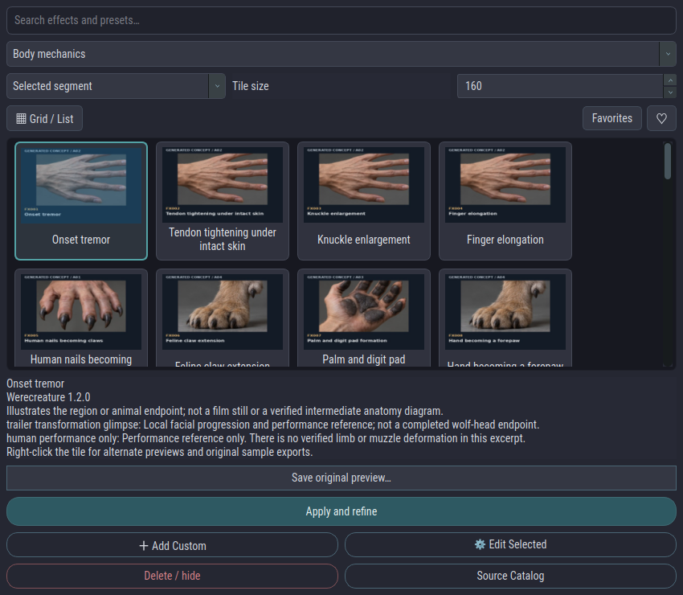
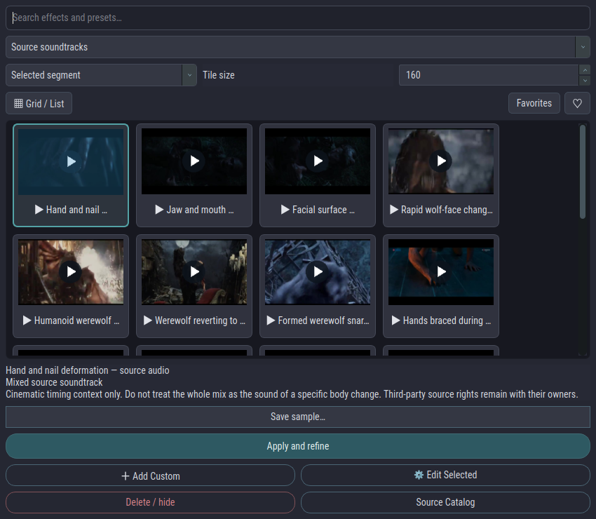

# Effects Library

Open **Effects Library** from the main toolbar or the last item in either **Quick Fix** menu. Search by effect name, anatomy, species, stage or prompt wording, and narrow the results with the category selector. The app includes all 100 Werecreature effects, their original catalog artwork, linked excerpt previews, 17 recorded source soundtrack samples, and 17 video reference tiles. Each bundled tile has a refinement instruction; source sounds refine sound design and video references refine the visual direction.

Use **Grid / List** to switch thumbnail layouts. Select an effect and click the heart to save it as a favorite; **Favorites** filters the browser to your saved entries. These choices do not change the source catalog or Quick Fix menu.

Select a tile to see its source and preview notes. Linked video excerpts play silently and automatically inside the selected tile. Click a sound tile to play its recording; click it again to stop. There is no separate preview selector. Right-click a tile for alternate previews and original sample exports when several references are available. Generated concept artwork is an appearance aid; excerpt notes describe what the footage actually demonstrates. The separate **Source catalog** opens the complete offline illustrated catalog and its provenance.

## Apply an effect

Drag a tile onto a timeline segment or its prompt editor. A green outline accepts the effect; a red outline means that target cannot accept it. The segment must have prompt text and refinement must be idle. A segment drop selects that segment and refines only its prompt, even if the editor previously used Global scope.

You can also choose **Selected segment** or **Unified prompt**, select a tile, and press **Apply & refine**. Each effect has an **Apply to** setting in **Edit**: Segment, Unified, or Both. Imported effects begin with Segment scope. Applying an effect uses the existing prompt review flow so you can inspect the rewrite. It preserves the shot structure and existing subject labels. Previewing a clip or sound does not attach it to an AI request.

## Sound

The **Sound** category contains written sound recipes. **Source soundtracks** contains the 17 actual recorded WAV samples. Sound tiles with recordings display a play symbol in the thumbnail; click to listen. Written recipes without a supplied recording are identified in their notes. Audio starts only on a click. **Save sample** copies the selected recording to a location you choose. Samples are mixed source soundtracks that may contain dialogue and music, rather than isolated foley. Only one library preview plays at a time; starting it pauses the project video.

Both sound recipes and recorded soundtrack tiles can refine the wording in a segment. Their instructions describe the intended sound; they do not attach or copy the mixed recording. Recordings remain preview assets until you explicitly attach them through a supported media workflow. Visual effects do not automatically enable their optional sound recipes.

## Automatic thumbnail maintenance

At startup, a background job checks the library artwork and preview files. Videos use silent, compressed **320 × 200** thumbnail copies, keeping the full source available for export. Missing or corrupt thumbnails are rebuilt from the associated video or a sound waveform where possible; corrupt cached videos are regenerated. The supplied catalog artwork stays in place whenever it is valid. Repairs use the application cache, preserve your files and edits, and need no image model or GPU generation. Unavailable sources are reported in the library instead of blocking other tiles.

## Your effects and menus

Your existing Quick Fixes migrate automatically with **Show in menu** enabled. Imported catalog entries have this option off. Select a tile, choose **Edit**, and check **Show in menu** to expose it in the appropriate Quick Fix menu. Category headings and the existing button menus remain compact.

Choose **Add Custom** to enter a name, category, scope and refinement instruction. Browse for a thumbnail and optional video or recording. **Generate thumbnail with default image model** uses the image source selected in Settings. Save to keep the effect. Cancel leaves the entry unchanged. Editing an imported entry saves your own override; the shipped source catalog remains intact. **Delete / hide** removes custom entries or hides an imported entry.

Drag the dock title to move or float the panel. Right-click the title for left, right, bottom and floating options, plus width and height boxes. Adjust **Tile size** to fit more items or inspect the artwork. Panel placement and tile size persist between sessions.
