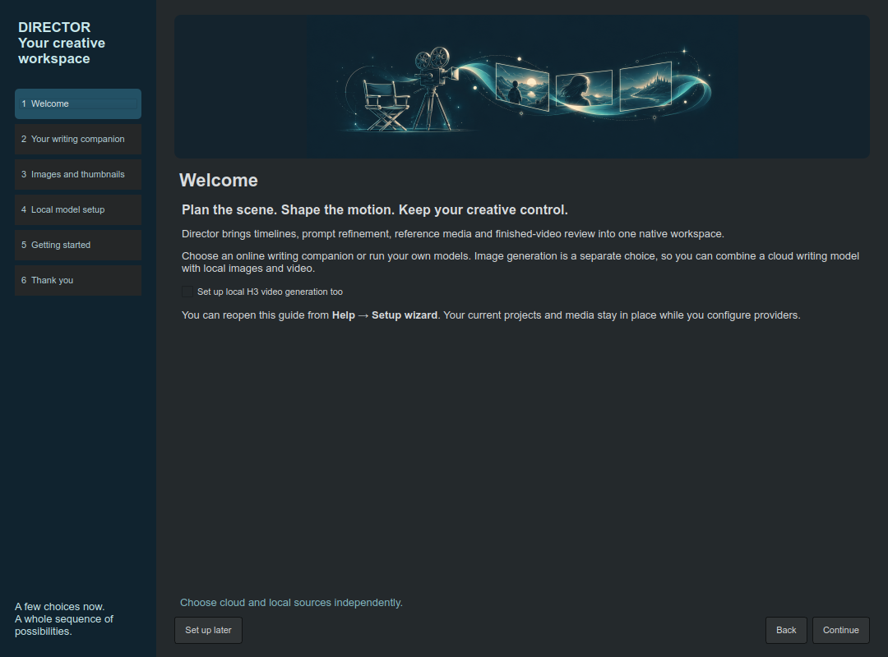
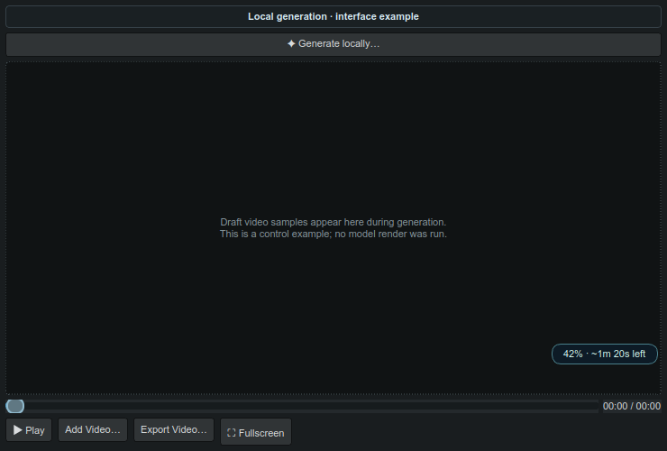

# Make images and video locally

Open **Help → Setup wizard** for a guided start, or **Settings → Local models** to change an existing setup. A new installation opens the guide automatically. Writing, images and video have separate sources: you can use Gemini to refine prompts while Flux makes artwork and H3 renders video on your computer.

## Choose a writing companion

**Gemini** is the recommended starting point when its free text tier suits your account and region. Open [Google AI Studio](https://aistudio.google.com/api-keys), sign in, choose or create a project and create an API key. Paste it into the wizard, choose an available text model and review [current model limits and pricing](https://ai.google.dev/gemini-api/docs/pricing).

**ChatGPT account** uses the existing browser sign-in controls. Continue with ChatGPT, grant eligible plan usage and select an available model. An account must be eligible for this integration, and its plan limits apply. See the [official sign-in guide](https://developers.openai.com/siwc/quickstart).

**OpenAI API** uses a key from your [OpenAI project](https://platform.openai.com/api-keys). Configure API billing and choose a model your account can access. API usage is separate from ChatGPT subscription usage. It is a useful option for detailed reasoning and structured edits; compare actual results on your own prompts.

**Local instruction model** uses a complete Transformers model folder with configuration, tokenizer and safetensors weights. Choose a folder you already have or download a Qwen instruction model. The file scan suggests a model size from detected VRAM; you can choose a different size or repository. Local writing has no API token charges, and its speed, memory requirements, context window and license depend on the selected model. The local writer uses authored prompt and timeline text; it does not analyze video or pretend to see images. Image-model Qwen encoders are kept separate from the writing-model chooser.

Use **Remember API keys on this device** only when you want keys stored in the app settings. With this option off, API keys last for the current session. Do not paste keys into prompts or projects. ChatGPT account credentials use the existing account connection controls.

## Choose an image source

The wizard defaults to **Gemini Flash Lite Image**. This is an image-generation model, separate from Gemini's similarly named text model. Gemini image API output requires a paid tier; a free text allowance does not supply free image output. Choose another image model or **Local · Flux 2 Klein** if that fits your workflow.

The default image source is used for segment artwork, image edits and **Add your own effect → Generate thumbnail**. The supplied Effects Library keeps its original catalog illustrations. Selecting a specific source never silently switches to a different billed provider.

## Prepare local models

1. Choose **Prepare local engine**. Director creates a private inference environment under its application data folder. The first installation downloads several GB of Python libraries and CUDA PyTorch. It does not alter your running ComfyUI instance or require a ComfyUI server.
2. Use **Find my model files** to scan your chosen model folder. The initial folder suggestion is `~/Programs/ComfyUI/models`, but any folder is allowed. Scanning reads filenames in a background worker and leaves model files in place.
3. For images, choose **Klein Base 4B** or **9B**. The scan suggests 4B on smaller GPUs and 9B when at least 20 GB VRAM is detected. This is a starting recommendation, rather than a guarantee: system RAM, canvas size and other running apps matter too. Pair 4B with its Qwen 4B encoder, or 9B with its Qwen 8B encoder, and select the Flux 2 VAE.
4. For video, select a **pruned H3** checkpoint, a supported H3 text encoder, video VAE and audio VAE. Choose Ref2VA for reference media, or FL2VA for text and first/last frames. The native backend supports the INT8 ConvRot encoder. If an existing NVFP4/AWQ encoder is discovered, setup explains that it needs an INT8 replacement for this engine. No Lightning or Turbo LoRA is loaded.
5. Select **Image models** or **Video models**, then **Get configuration files**. This downloads tokenizer, processor and model configuration files needed alongside your weights. It does not download the model weights.
6. If weights are missing, choose **Download model set**. Review the approximate size before downloading. Matching files already selected in the dialog are reused. Gated repositories may require accepting the model's terms on Hugging Face and entering a token in the dialog; that token is kept only for that dialog.
7. Save Settings or finish the wizard. Its final page lists incomplete setup so you can return later. You can also choose **Set up later** and keep using the editor.

FP8 image checkpoints are expanded into a derived BF16 compatibility cache one tensor at a time. Sequential offload limits GPU residency during image inference. Original model files are untouched. This cache needs extra disk space and can make the first run longer. The local video engine uses disk offload to limit host memory pressure. Other apps keep their processes and models; free GPU memory before requesting a local render. Quantized native H3 uses an NVIDIA GPU; CPU mode is available for images and writing.

## Generate a video

Open **Video Preview → Generate locally**. Review the prompt, duration, canvas and sampling steps. Check the timeline references you want to attach; video references are silent. H3 aligns duration to its frame grid. Small canvases reduce memory and render time.

During rendering, the player shows draft samples decoded from the current video latents. The pill at the bottom right shows sampling percentage and an estimated remaining time once measured steps are available. Loading and preparation show a stage message until an estimate is meaningful. Draft samples can be noisy and show only the opening chunk; the finished video contains the full generated duration and audio.

**Cancel generation** stops that Director worker. A completed video appears in the preview and is attached to the current saved project. For an unsaved project, the generated file remains in the local generation folder and can be exported through the player. Switching projects while a job runs prevents its result from replacing the new project's preview; its output remains available in the generation folder.

## Generate artwork and effect thumbnails

Choose **Local · Flux 2 Klein** as the default image source. Use a segment's **Generate Artwork** or **Render requested artwork** action. The **Image generation** panel shows draft images, sampling percentage and estimated time. Final artwork follows the existing segment review workflow; source media is retained.

In **Effects Library → Add your own**, write the effect instruction and choose **Generate thumbnail**. The dialog uses the same image source and shows local draft previews and progress. Save to keep the custom effect. Cancel leaves the effect entry unchanged.

## Get help as you work

**Help → Interactive illustrated manual** opens the complete offline guide in your browser. Search the manual, jump between chapters or take the short guided tour. The wizard's Getting started page has three core slides, followed by a thank-you page and a placeholder for the future donation link.
