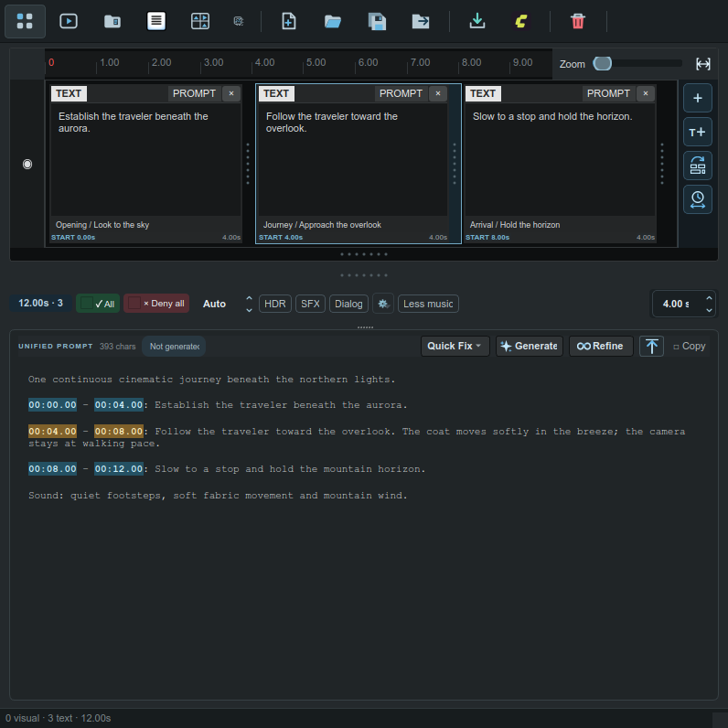
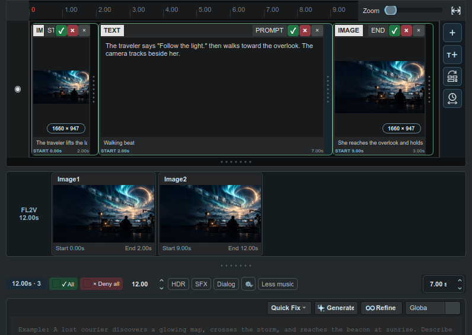
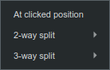
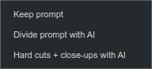
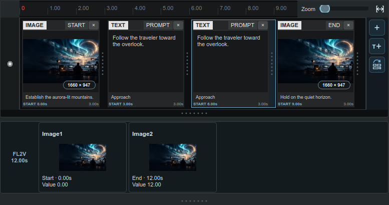
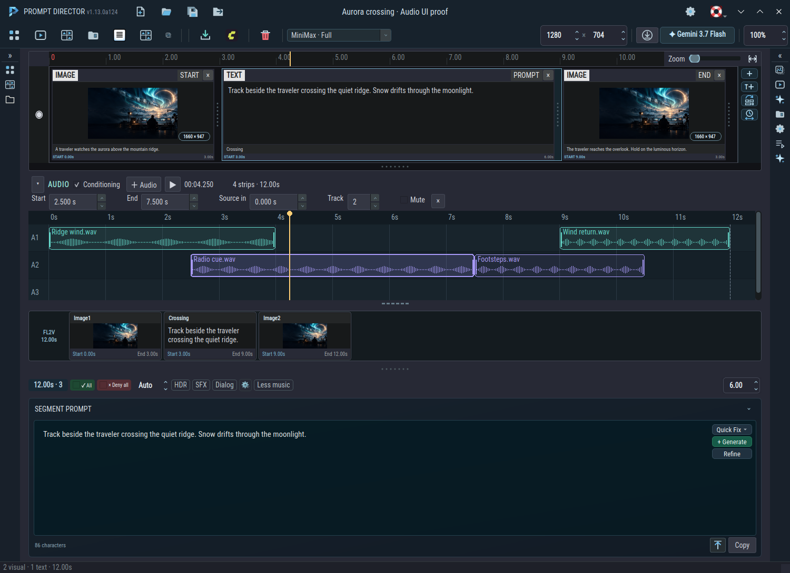
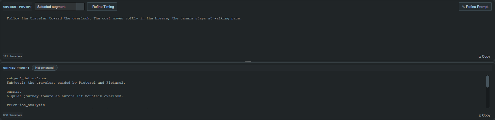

# See every beat. Shape every transition.

## Build the sequence in pictures and words

Director’s timeline gives your prompt a visual structure. Each card has a duration, a place in the story and a prompt you can edit. Mix reference images, source clips and text to describe the sequence at the level of detail you have today.


## Bring in the right material

| Segment | Use it for | Add it with |
| --- | --- | --- |
| Image | Identity, composition, an opening state or a target pose | Add media or timeline drag-and-drop; PNG, JPEG, WebP and GIF |
| Video | Source footage or movement context | Add media or timeline drag-and-drop; MP4 and WebM |
| Text | An action, pause or transition without its own reference image | Add text |

Drop media near the position where you want it inserted. The timeline shows when it is accepting a drop. Project archives and Director JSON dropped into supported project or timeline areas open or import their workspaces.

Videos use a preview frame from the clip’s final second for the timeline and AI image context. The complete source clip remains available for project storage and export. A GIF is handled as image media; use MP4 or WebM for a video segment.

## Make timing tangible

Drag a card to reorder the sequence. Select it and enter a precise value in **Duration** to edit its length. The sequence summary shows the total; each card shows its starting time. Image and video cards also show source resolution.

Drag the dotted divider **between two cards** to transfer time from one to the
other: moving it right lengthens the left segment and shortens the right, and
moving it left does the reverse. Their combined duration and every later start
time stay fixed. The drag snaps to frames and stops at one frame per segment or
the available video source limits. The final card's right grip changes the
overall length; the Duration field still edits a single card.

Recognized timecodes in the **unified prompt** follow manual timeline edits
immediately, using local pattern matching without an AI request. Director
counts through the segments in order and highlights `MM:SS.xx`, `HH:MM:SS`
and 24 fps SMPTE codes. A range uses both segment boundaries; a lone code uses
the segment's **Start** or **End** frame mode. Reordering cards, dragging a
divider, editing Duration or changing that frame mode updates the codes while
preserving your prose. Resizing keeps the text cursor and selection in place.

Click a card to emphasize its matching timecode and scroll the unified prompt
to it. The cursor lands just after the start code, or the end code in End mode.
Typing refreshes the highlights without changing the timeline or rewriting
your text. Broken codes are skipped, later valid codes continue matching in
order, and extra cues stay as written. Repair a code to reconnect it on the
next timing edit.



Use the **Re-time all** clock button beneath Rewrite Timeline in the right rail
to distribute time using dialogue delivery, action, camera movement, frame roles
and shot pacing. Set the sequence-length box below the timeline to the desired
total first; **Auto** (0) keeps the current total. The proposal moves the tiles
and offers approve/revert controls. Approving or rejecting any timing change
resolves the complete timing pass. Segment prompts, visual directions, global
guidance and the unified prompt remain unchanged. Video source limits and the
workspace's duration limit still apply.



Right-click a card and open **Split segment**. **At clicked position** divides
the card where you clicked. **2-way split** and **3-way split** create equal,
frame-aligned parts with these choices:

| Choice | Result |
| --- | --- |
| Keep prompt | Each part keeps the original prompt |
| Divide prompt with AI | The model distributes the prompt's action beats chronologically across the parts |
| Hard cuts + close-ups with AI | The model divides the action into shots, establishing it first and cutting to close-ups in later parts |

Every split preserves total duration and original media. Video parts use
consecutive source intervals. AI splits use the configured prompt provider and
offer one review for the entire split: approve any part to keep all parts, or
deny any part to restore the original segment. Other segments and the combined
prompt stay as authored. Each part needs at least one frame. Pending timeline
reviews and the workspace's **Maximum shots** setting control availability.





Use **Zoom** beside the timeline ruler to inspect a passage. The
**Fit timeline** icon at the right edge brings the whole sequence into view; moving
Zoom all the way left also fits the sequence. Drag the dotted lower grip to
make the visual previews taller. Smooth horizontal scrolling helps you move
through longer plans.

The conditioning tiles beneath the timeline show larger previews, frame roles
and Start/End timing values. Text segments remain in the overview with their own
prompts and time ranges; adding, resizing or removing a segment updates the strip.
Scroll horizontally to see additional segments and references. Drag the dotted handle beneath the tiles down to enlarge them, or
up to hide the strip completely. Double-click that handle to hide or reopen
the strip. Its size and collapsed state are remembered.



There is no fixed segment-count or total-length cap in the editor. The renderer you use still determines which output lengths it can produce.

## Place conditioning audio beneath the sequence

The **Audio** timeline is available in every workspace, including Shot Sequence.
It starts collapsed and opens when you add sound, leaving space for the editors.
Use **＋ Audio** to import WAV, MP3, FLAC, Ogg, Opus, M4A, AAC or AIFF sound,
or drop several files directly onto a track. Video containers with an audio
stream are also accepted. Each strip displays a waveform of its source sound.

Drag a strip freely along its track or onto another track. Strips can overlap,
start together or leave any amount of silence between them. Moving or trimming
one strip leaves the other strips in place. Drag either edge to frame its source
interval; select it to enter exact **Start**, **End**, **Source in** and **Track**
values. Times snap to 24 fps frames. Changing Start moves the strip; changing End
trims its length; Source in chooses where playback begins in the original file.



Drag the audio ruler to scrub with an immediate playhead and time readout plus
brief audio audition. The arrow keys step by one frame. **▶** or Space on the
audio timeline plays the strips together, including silence in the gaps. In
Shot Sequence, scrubbing also seeks the movie preview. Select **Mute** to silence
one strip, or clear **Conditioning** to exclude all independent audio from
audition and LTX export.

Drag the dotted grip beneath the audio tracks to resize the panel. Drag up or
double-click the grip to collapse it; double-click again or use the header arrow
to reopen it at its previous size. Tracks scroll vertically when needed.

Native **.LTXD** saves include the original audio files, track positions and source
trims. LTX timeline JSON export copies enabled, unmuted audio into the configured
ComfyUI input folder and includes independent audio segments. Other renderer
handoffs and the completed-shot movie bake do not yet consume these independent
audio tracks.

## Anchor the opening and the destination

**Start frame** tells a compatible workflow to begin a segment from its supplied image. **End frame** describes the image it should reach by that segment’s end. These controls are available in LTX and MiniMax.

Click a card to edit its segment prompt. In MiniMax, this automatically switches
the upper editor to **Segment**, including when you click the selected card
again. Choose **Global** to return to whole-sequence direction. MiniMax keeps an
independently editable unified production prompt below it. Refining a segment
can update its duration and the timeline; typing in the unified box preserves
segment timing.



## Update the image without rebuilding the beat

Use **Replace media**, or hold **Ctrl** while dropping media onto a card, to retain its duration, prompt, role and identity while changing the source. This is useful when a revised pose or a cleaner frame is ready.

An image card’s context menu includes **Copy image** and **Paste image to replace**, using the original-resolution source. For a text card, **Convert to image segment** lets you add an image while keeping the written beat. **Export image** and **Export video** place the original media in the project’s download folder.

Choose **Convert to text segment** on an image or video card to keep its prompt,
visual direction and duration as a text beat. Its original file remains intact;
the text segment carries no media or source trims.

When opening older projects, Director checks the stored media type and
normalizes media names and cache extensions. Duplicated attachments and media
exports use safe filenames with the actual file extension, preserving the
original source bytes.

Delete a card with its close control, the toolbar’s **Delete selected** action or the context menu. Revisit the surrounding action after a large sequence change so the written transitions still describe the plan you intend.

## Build the plan from a timed brief

In a unified workspace, paste a brief whose timed-action lines use 24 fps SMPTE ranges:

```text
00:00:00:00 - 00:00:03:00: Establish the traveler beneath the aurora.
00:00:03:00 - 00:00:08:00: Follow the traveler toward the overlook.
00:00:08:00 - 00:00:12:00: Settle into a quiet horizon hold.
```

Director matches the actions to existing segments in order, preserves their media, resizes their durations and creates text segments for extra valid actions at the end. A whole-brief paste replaces the brief; a timed-action-only paste retains the surrounding sections.

Start at zero and keep ranges continuous, ascending and nonempty. The final two digits are frames from 00 to 23. If a range is missing or invalid, unmatched cards turn gray while their media remains intact. Correct the timed block or refine the prompt to reconnect the plan.

**Continue:** [Prompt workflows](unified-workflows.md) · [Exports](workspace-definitions-and-exports.md) · [Complete feature guide](../usage.md)
