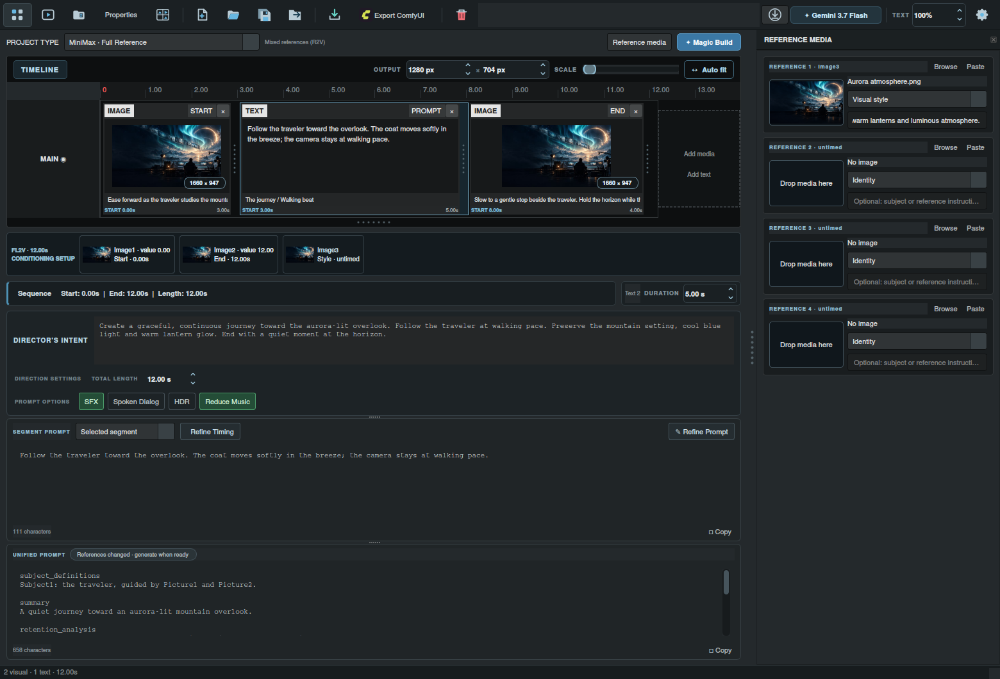
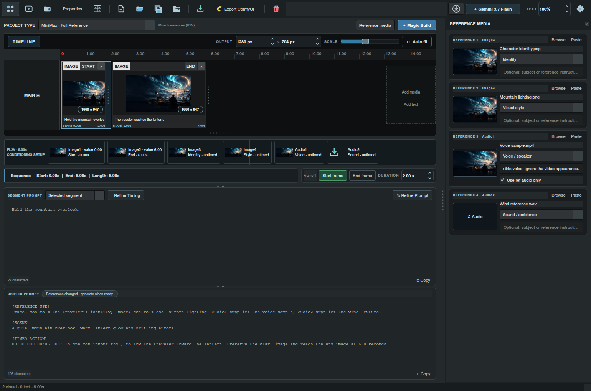

# Give every reference a purpose.

## Four sources. One coherent production brief.

Use a picture to guide a face, wardrobe, atmosphere, prop or composition without placing that picture at a particular second. MiniMax’s four mixed reference slots keep images, videos and sound samples beside the timeline and production brief. Each reference carries its own role and notes.

## Add the image. Define the role.

Open **Reference media** in a MiniMax timeline workspace. Drop an image, video or audio file into any of the four slots, click **Browse**, or use **Paste** for clipboard image pixels or a local media file. Choose the role and add notes describing exactly what to use.

| Role | Guide the generation toward |
| --- | --- |
| Identity | A subject’s recognizable features |
| Wardrobe | Clothing, accessories and their details |
| Setting | Environmental or location attributes |
| Visual style | Lighting, palette, atmosphere or treatment |
| Object / prop | A particular item and its appearance |
| Composition | Framing and spatial arrangement |
| Voice / speaker | Vocal identity, timbre or performance |
| Sound / ambience | An ambient or physical sound texture |
| Motion / camera | Movement or camera behavior from a video |

For the Aurora scene, choose **Visual style** and write “Use the cool sky, warm lanterns and luminous atmosphere.” That gives the picture a clear job while the timeline continues to describe when the traveler moves and arrives.

References keep their original resolution in the saved project. AI analysis uses a size-limited copy. Roles and notes travel with the .LTXD project. Right-click the reference image and choose **Export Media** to save the full-resolution stored image into the project’s export folder. It also appears in Recent exports. Automatic filenames avoid overwriting earlier exports. **Clear** in the same context menu removes only that slot’s reference; it does not remove timeline media or change the sequence’s duration.

## Use a video for its soundtrack

For an uploaded video sample, enable **Use ref audio only** to use its soundtrack without borrowing its visual appearance or motion. The checkbox is available when the imported video contains a usable audio stream. Leave it off to use the video and its paired soundtrack together. Standalone audio files can be dropped into a slot directly.

Video and audio originals are copied into Director’s managed media folder. Their soundtrack and selected audio-only state travel inside saved .LTXD projects. Gemini receives the actual audio for prompt analysis; with OpenAI, provide explicit sound notes because this transport does not audition reference audio. Both providers export the real audio into the ComfyUI graph.

## Export directly to ComfyUI

Choose **Export ComfyUI** in the top toolbar, marked with Comfy’s official logo. The exporter adapts the supplied MiniMax graph, fills its prompt and duration, and applies the pictured 16:9 / 0.5 MP / multiple 32 / 20-step defaults, and copies referenced media into **ComfyUI/input** using the existing ComfyUI root setting. Exported `Load Image`, `Load Video` and `Load Audio` fields use those relative input paths. Repeated exports avoid overwriting prior input files.

All timeline images connect directly to their timed condition nodes, including the image at zero seconds; timeline videos feed their full frame batch and soundtrack into a timed audiovisual guide at their starting position. Later image checkpoints are chained at their cumulative timeline times. Two end images lasting 3.0 and 7.5 seconds anchor at **3.0** and **10.5** seconds. Audio-only references go to standalone audio inputs; untimed video-reference soundtracks go to paired video-audio inputs.

The graph retains the supplied model, sampler and decoder subgraphs. ComfyUI needs the same native MiniMax and custom nodes used by that base workflow. The export checks the native node’s media limits: 9 image inputs, 3 video inputs and 3 standalone audio inputs. Director still offers four mixed reference slots; timed conditioning assets are additional inputs.

## Choose the right source pattern

**MiniMax** recognizes the supplied combination and prepares the prompt around it:

| Your inputs | Recognized workflow | How to direct it |
| --- | --- | --- |
| Text segments | Text to video | Describe the scene and action; use segment durations for pacing |
| One timeline image | Image to video | Describe movement from or toward the image, using its frame role |
| Two timeline images with start and end roles | First / last frame | Describe the visible path from the opening state to the destination |
| Other multiple-image timelines | Multiple keyframes | Describe the progression through the ordered visual checkpoints |
| Timeline video without images | Video to video | State whether to edit, continue or draw movement guidance from the source |
| Images and video, or an untimed reference slot | Mixed references | Explain each asset’s role and which attributes to preserve |

A start image anchors the beginning of its segment; an end image is reached at the segment’s end. Hover over the detected workflow label to inspect asset labels and checkpoint times. Video ranges follow the source metadata retained with the segment.

## References and timeline frames work together

Use **MiniMax Full Reference** to combine timeline checkpoints, source video, and four untimed media references in one production brief.

An untimed image supplies attributes rather than chronology: it does not add a segment, move a checkpoint or extend the plan. For a sequence guided entirely by the reference slots, add a text segment to establish the action and duration.

## Generate, review and refine

Write your intent and develop the segment prompts with **Magic Build**. Review reference roles in the full production draft and edit it directly. After segment changes, the **Regenerate** action in the change notice can rebuild an existing draft using the selected template.

Image labels and video labels are assigned consistently within the asset inventory. Changing a reference remains a preparation step; you choose when to submit another generation or refinement request.

**Continue:** [Prompt workflows](unified-workflows.md) · [Refinement](refinement-and-audio.md) · [Complete feature guide](../usage.md)

Drag a reference image into your file manager or the timeline to use its full-resolution image. Drop a still image from your file manager onto a reference slot to replace it. The image highlights on hover, and a blue border marks an accepted drop.

The final **Video Combine** node saves a 24 fps WebM with YUV420p, CRF 15, metadata and audio trimming enabled. Media and conditioning occupy separate groups; unused sample guides and video branches are removed. The **Get Condition → Set Cooked Condition** connection is retained when there are no timed guides.

Timeline videos connect **Load Video → IMAGE** and **Load Video → audio** to the timed condition node at the clip’s start. The full loaded batch supplies frame conditioning; its audio shares the same time anchor. Opening still fallbacks and tail-only video samplers are omitted. Still-image checkpoints retain their conditioning guides. Guided output may differ from the source; no automatic audio crossfade is applied.

Timeline video segments use **MiniMaxH3AddGuide only**, with frames and audio at the same start index. They do not consume native video-reference inputs. Prompt generation and refinement use the original a32 rules and asset labels.

Timeline images and videos are conditioning media only. Native reference inputs are populated exclusively by the four reference slots. The Lazy Switch and first-frame Set/Get detour are removed from exports.
