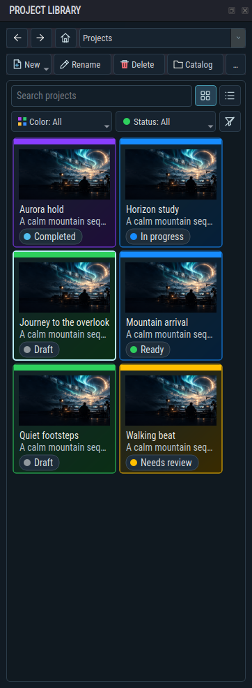
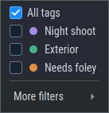
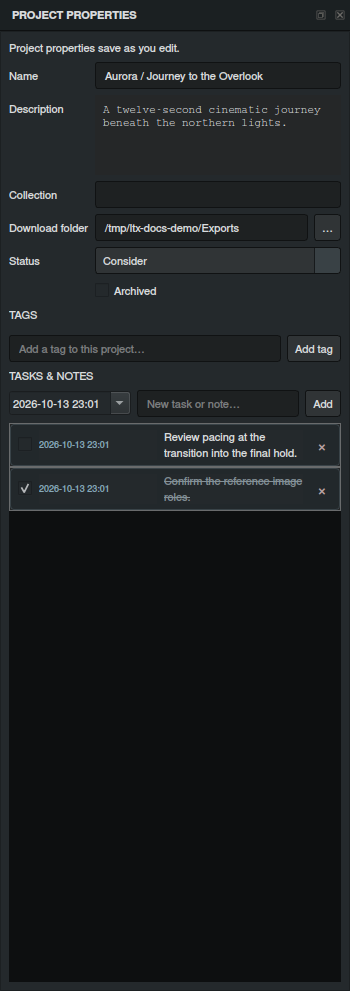

# A home for every creative project.

## Turn individual experiments into a collection of work

Your project is more than a prompt. It includes the reference media, the timing, the creative intent and the decisions that make the sequence yours. Director’s local library keeps that context together in a gallery you can browse, organize and reopen.

## Save it with a name and a cover

**New Project** immediately creates an empty **Untitled project** in the
library. You can switch to another project and return to its working draft
before saving manually. Rename it and add a description in **Properties**.
Choose **Save to Library** to save its content; later saves update that same
project. In project details, choose a segment frame as its cover or upload a
custom thumbnail. A recognizable cover helps you find the right plan as the library grows.

Open **Projects** from the toolbar. Select a saved project to return to it, or use its context menu to open it or edit the details. Search matches names, descriptions, statuses, tags and notes. Use the grid/list buttons beside search to choose a view. The **…** menu retains sorting, thumbnail sizes, duplication, details and archive controls. **New**, **Rename**, **Delete** and **Catalog** stay in the compact action row.

## Arrange the library around your work

Assign a **Collection** to group related projects. Collections appear as gallery tiles, with covers assembled from member thumbnails. Open a collection or choose it from the breadcrumb menu. **Back**, **Forward** and **Home** navigate the library without opening or changing a project.

Choose **Title A–Z**, **Title Z–A** or **Custom** sorting. Dragging a project or collection establishes a custom order. Status and label filters help narrow the gallery; the app remembers your selected filter choices.

## Make progress visible

A project has one **Status** and can have several additional **Tags**. Its status appears as a colored pill under the cover and description. The stock choices include Draft, In progress, Ready, Needs review, Completed and Failed. Older Done, Consider and Re-shoot statuses remain available. Customize definitions in **Settings → Application**.

Right-click a project or collection and choose **Card color** to set an independent color for its border and top strip. **Use status color** restores the previous status-based appearance. The **Color** filter selects explicitly assigned colors; **No color** includes cards using their status color. **Status** provides checkboxes that stay open while you select multiple statuses. **More filters** retains no-status, legacy-status, additional-tag and archive choices. The reset-filter button clears search and restores the active-project filters.

Archive a project when it should move out of the active flow while remaining available. Collection context actions can apply status, labels and archive choices to their members. Deletion is a separate confirmed action that removes the selected saved project.

## Put the next steps beside the plan

Open **Properties** to edit the project name, description, collection, download folder, status, archive state and tags in a dock. Metadata edits save as you work. The context-menu project-details dialog provides another way to edit the same project information.

Add dated tasks and notes, edit their text or date, check them off when complete, and remove them when they no longer apply. A note such as “Review pacing at the transition into the final hold” stays with the project instead of becoming a loose reminder elsewhere.

## Switch ideas without losing the working draft

Several saved projects can remain open as in-memory workspaces. Switching restores each project’s timeline, prompts, options and view. Use **Save to Library** to write creative edits to disk; closing the app saves dirty library projects with visible progress. Give a new unsaved project an initial library save or portable export to establish its destination.

LTX and MiniMax retain their prompt drafts across workspace changes. Projects also retain their attached review video and workflow JSON files, so you can return to the prompt and its production context together.

## Carry the complete project

**Export Project** writes a portable **.LTXD** archive to the download folder. It preserves editable sequence state, original-resolution timeline media, prompt drafts, intent and supported project attachments. **Open** restores a native project; **Import** reads Director JSON.

Timeline previews are kept separately from the original media to make navigation and loading more responsive. Original-resolution files remain the sources used for project and media exports. The preview cache can be rebuilt; keep important work in a saved project or exported archive.

## Arrange a workspace that stays comfortable

Move, resize, show or hide the project library, Properties, Preview and Project Files docks. Supported docks can float; reference images stay docked inside the main window. Panel layout and sizes are remembered. Adjust toolbar text scale from **75% to 200%** to suit your screen.

**Continue:** [Video review](video-review-and-files.md) · [Portable exports](workspace-definitions-and-exports.md) · [Complete feature guide](../usage.md)
