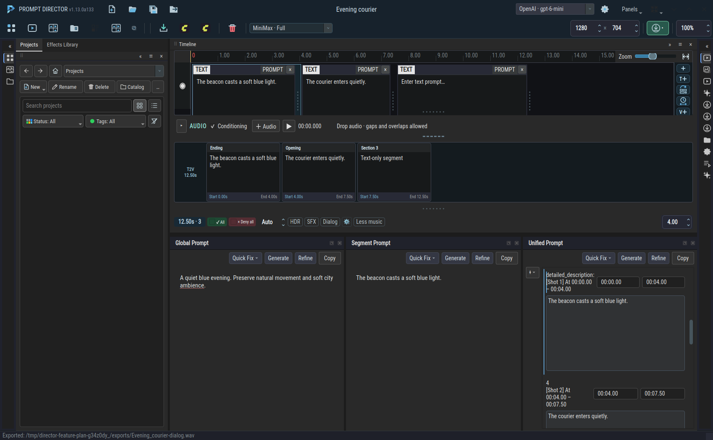
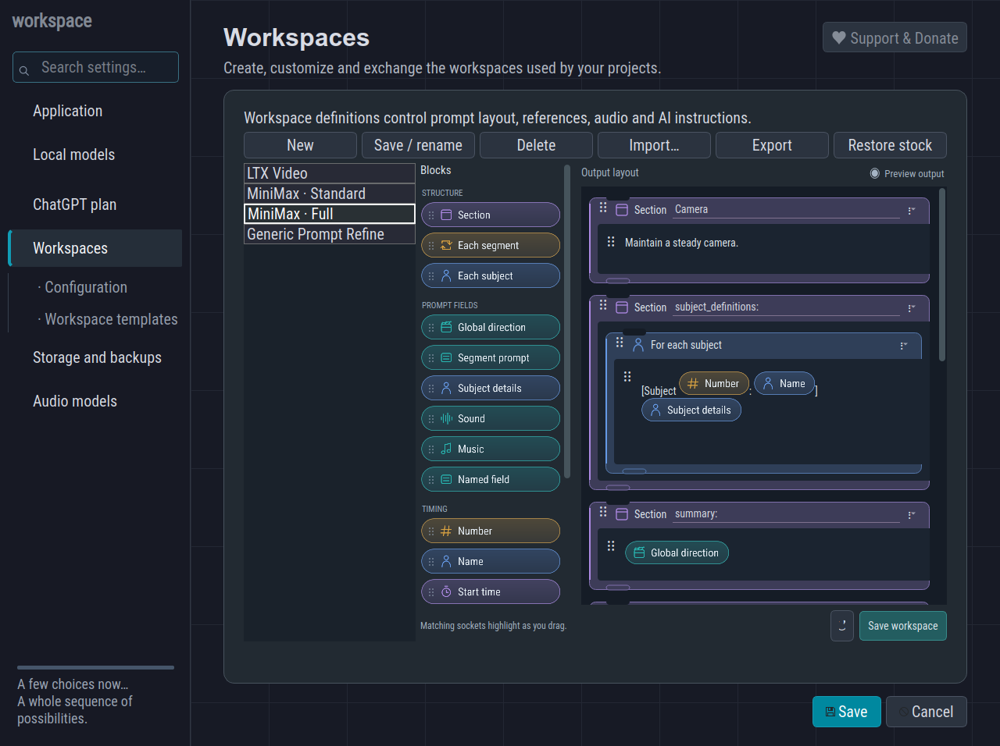
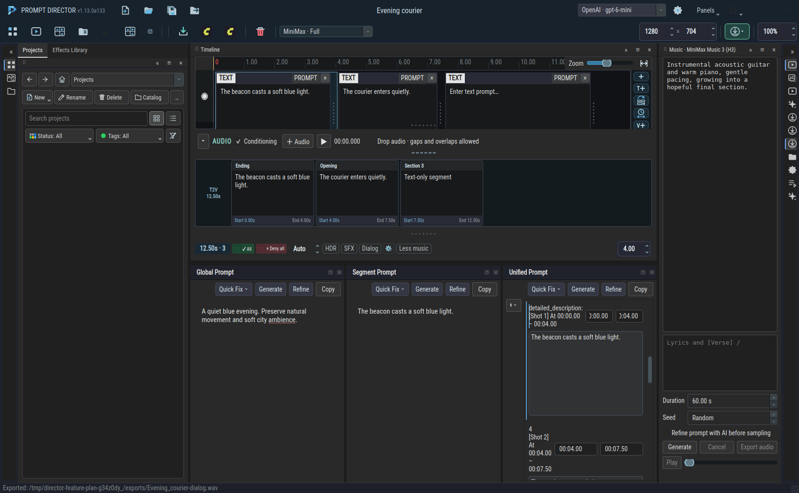
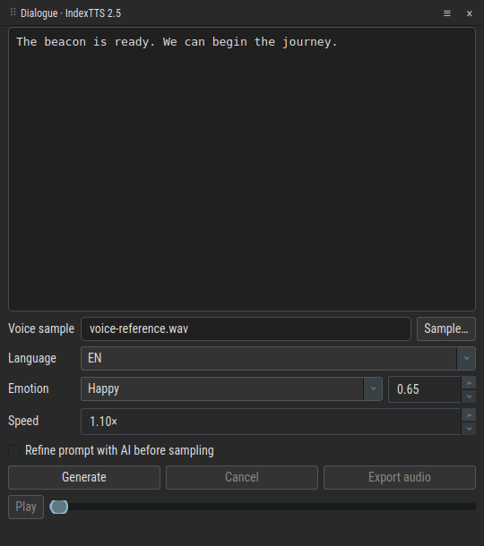

# Arrange your prompt documents and build audio alongside them

Open **Panels** in the application header to show **Global Prompt**, **Segment Prompt**, **Unified Prompt**, **Timeline**, or an audio generator. LTX Video offers Global and Segment panels. MiniMax also offers Unified Prompt. Each supported prompt is its own dockable panel. Drag its heading to rearrange it, float it into a separate window, or close it and reopen it through Panels.

The Timeline is also a native dock: float, resize, close or restore it through **Panels**. It keeps the ruler, audio strips, conditioning overview and sequence options together. The options row scrolls horizontally when the panel is narrow.

Global describes the whole sequence. Segment edits the selected timeline entry. Each has its own Generate and Refine controls. The Unified Prompt presents the output in your workspace's template, with shaded editable areas and fixed surrounding text.

Typing in Segment updates its matching Unified section immediately, without an AI request. Moving a timeline entry moves its section; changing its duration updates its timecodes. Click a timeline entry to scroll Unified to that section. Clicking the same entry again brings it back into view after you scroll elsewhere.

Use **+** at the left of Unified to add a timeline section or subject definition. A new timeline section also creates a text entry on the timeline. Edit a section's start or end time to move its boundary or resize it, within the workspace's duration limits. Editing section text updates the segment prompt and its text preview.

## Define the complete output in one canvas

Open **Settings → Workspaces → Workspace templates** and select a MiniMax workspace. Arrange the complete output in a single visual canvas. The default install contains **MiniMax · Standard**, **MiniMax · Full**, **Generic Prompt Refine** and **LTX Video**. Unified templates apply to the MiniMax workspaces; LTX retains its separate global and segment formats, while Generic Prompt Refine works directly on the text you supply.

- Add a **Section** block and type the heading you want in the output.
- Drop a **Global direction**, **Sound**, **Music**, or **Named field** pill into a section. Named fields can be renamed through their context menu.
- Place **Each subject** or **Each segment** inside a section. Their contents repeat for the corresponding references or ordered timeline entries.
- Put **Subject details** and **Segment prompt** into their matching repeat groups. Timing pills belong inside **Each segment**. Matching sockets highlight while you drag; incompatible placements are rejected.
- Type literal wording around pills in a text slot. Use **Text** or **Blank line** for additional instructions and spacing. Drag an existing pill to reposition it, or drag a container's grip to move the whole nested group.

Choose **Preview output** to see how the layout reads with prompt content. **Save workspace** applies the template. The reset arrow restores the selected model's starting layout. Exporting a workspace includes its layout; saved projects retain their section edits and subject definitions. AI generation receives an explicit schema for the fields in the template, and the application places its response into that layout.

Opening an older MiniMax project separates its saved summary, retention analysis, detailed shot descriptions, sound, music and subject definitions into their template fields. This happens locally once and is recorded when you save the project. Timeline prompts and existing template edits are preserved.

## Add and update reference definitions

Unified Prompt includes definitions for timeline images and videos, imported image/video/audio references, and a video's paired soundtrack. Audio-only video references supply only an audio definition. Saved Video and Picture definitions stay associated with their source media.

The floating **+** offers **Timeline section**, **Subject definition**, **Image reference**, **Video reference**, and **Audio reference**. Media choices open a file picker and use an available Reference Media slot within the workspace's limits. Use **×** beside a section or subject to remove it. Removing a timeline media definition keeps the timeline media; removing a timeline section removes that section. **Remove** in Reference Media removes the source reference and its paired definitions.

In Reference Media, choose **Generate** or **Regenerate** for one reference, or **Generate definitions** for all definitions. These actions use your selected writing model and update the existing Unified definitions, preserving summary, retention analysis, shot prose, sound, music and timeline timing. A result is discarded if its source media or definitions changed while it was running. Providers that cannot listen to audio use your explicit notes.

After removing, replacing or changing references, choose **Reassess references** to reconcile their use throughout the existing Unified prompt. It makes small edits to reference mentions in the summary, retention analysis, shot descriptions, sound, music and definitions. Deleted voice references lose their source attribution while spoken dialogue and unrelated wording stay intact. Reference-change history distinguishes a removed file from a remaining file that inherits its number. This is a separate, explicit action; generating definitions does not reassess the rest of the prompt.

Reassessment uses the writing model selected in the toolbar. It updates all related prompt text together: timeline/segment prompts, image/artwork prompts, Global direction and intent, Unified sections, and remaining reference notes and definitions. Each draft retains its own unrelated wording; Unified prose is not copied over the timeline. The model returns revised text directly, without literal-snippet matching or a separate content checker. Timing, order, media and settings stay intact. If you edit a draft or switch projects during the request, the newer work is preserved.

## Generate dialogue, Foley and music

The audio panels are available alongside every video workspace:

| Panel | Inputs |
| --- | --- |
| Dialogue · IndexTTS 2.5 | Spoken script, voice sample, language, emotion, strength and speed |
| Foley · Stable Audio 3 | Sound description, duration and seed |
| Music · MiniMax Music 3 | Music description, optional tagged lyrics, duration and seed |

Open **Settings → Audio models**, or the audio section of the setup wizard, to choose existing engine environments and model files. **Prepare engine** creates a separate local runtime. **Download models** retrieves the corresponding model files. These operations run in the background.

Write a prompt and choose **Generate**. **Refine prompt with AI before sampling** optionally improves the sampling input in the background using your writing model, while leaving your visible draft intact. Music refinement uses MiniMax's [Music Caption Rewriter](https://github.com/MiniMax-AI/MiniMax-Music3/tree/main/skills/music-caption-rewriter), choosing style references progressively and keeping lyrics separate from the caption.

**Dialogue controls:** Leave Emotion on **Match voice sample** to retain the reference delivery, or choose an emotion and adjust its strength from 0 to 1. **Speed** ranges from 0.5× to 2×; higher values speak faster. These controls apply directly during local IndexTTS sampling.

Use the panel's player to listen and seek. **Export audio** saves through the existing download manager and appears in Recent exports. The music ComfyUI button in the header exports an editable Music 3 workflow with the panel's description, lyrics, duration, seed and configured model filenames. Install those models in the receiving ComfyUI instance before running it.

## Choose the writing model quickly

Use the model dropdown in the application header to change the model for your next prompt request. It switches the saved choice directly.

In an effect's details, **Prompt refinement model** can select a particular writing model for that effect. **Use current model (any model)** follows the toolbar choice. Existing and imported effects without a saved model preference use the current model.
