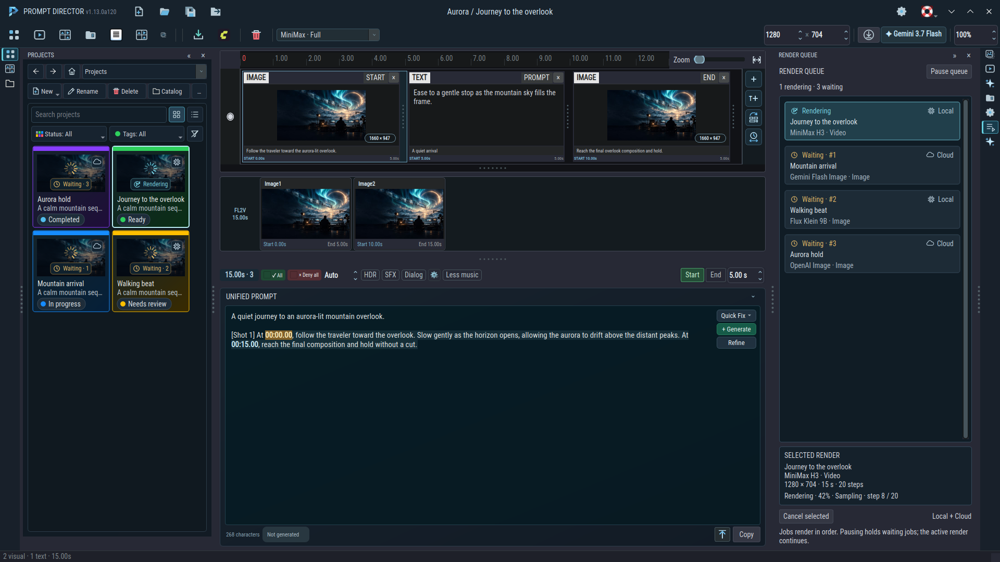
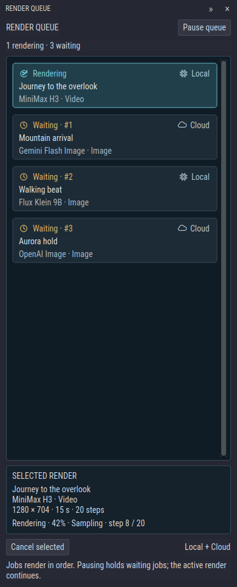

# Render in order and arrange your panels

## Queue local and cloud renders

Start a local video from **Video Preview → Generate locally**. Generate artwork from a timeline segment, a model's approved artwork request, or **Effects Library → Add your own → Generate thumbnail**. Director adds these image and video requests to the same **Render Queue**, including local Flux, local H3, Gemini image and OpenAI image requests.

One render runs at a time, in submission order. You can keep editing and switch projects while the queue works. Each request keeps the prompt, model settings, reference media and output size it had when submitted. Images return to the original project's segment; an edited or replaced target is preserved. Saved projects retain generated videos as their preview attachment.

Open **Render Queue** from its icon on the right rail. Select a job to see its model, dimensions, state and available progress. A failed job keeps its error in the selected-render details.

## Read the thumbnail indicators

The **chip** means a local render; the **cloud** means a cloud image service. The queue also spells out **Local** or **Cloud**. A cyan progress icon marks **Rendering**; an amber clock marks **Waiting**, followed by its queue position.

Project cover images show an animated spinner while their jobs are waiting or rendering, with a small source icon and a state badge. These temporary indicators do not change the project's saved status, tags or card color. If a project has several jobs, its active render takes precedence on the cover; the queue lists every job separately.

## Pause or cancel

**Pause queue** holds waiting jobs while the active render continues. Choose **Resume queue** to continue. Select a job and choose **Cancel selected** to remove a waiting request or request cancellation of an active render. Active jobs show **Cancelling** until their worker finishes. A cloud request already in progress may need to return before cancellation completes; its result will not replace the segment.

The queue belongs to the current app session. Closing Director cancels waiting jobs and requests cancellation of the active render while finishing project saves. Completed media and saved project edits remain available.

## Use collapsible panels

Click an outer icon to open its panel. Click the active icon again, or the double arrow in the panel heading, to collapse the column to icons. Switching panels retains their contents. **Projects**, **Effects Library** and **Media Catalog** start on the left; references, previews, files, properties, the queue and AI activity start on the right.

Drag a panel heading to move it. Right-click the heading for docking locations, supported floating options, or **Close panel**. Effects Library retains its panel sizing controls under **Panel sizing and options**. You can reopen a closed panel from its icon. Positions and column widths are remembered. A workspace without Reference Media hides that panel and its icon; returning to a supported workspace restores it if it was open.

The integrated header keeps file commands and window controls beside the centered project title, with workspace, preview, output-size and provider tools on the next row. Drag empty header space to move the window; double-click to maximize or restore. The timing overview stays beneath the timeline.

**Continue:** [Local generation](local-generation-and-setup.md) · [Project browser](performance-and-properties.md) · [Complete feature guide](../usage.md)
