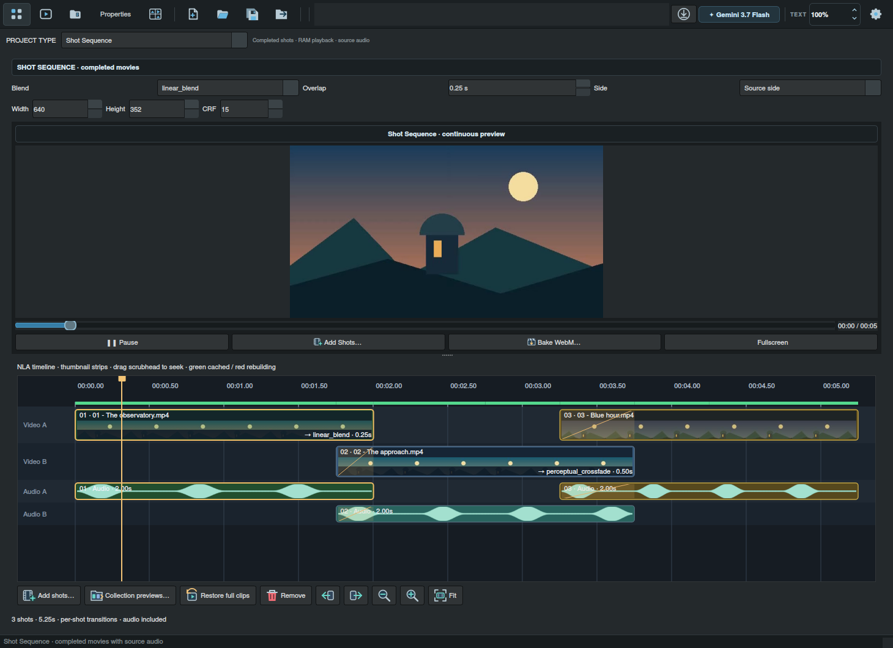
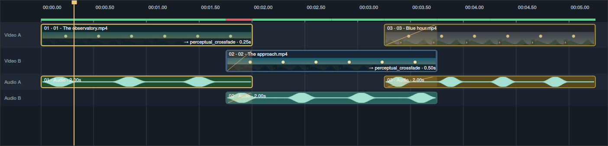

# Finish the film, shot by shot

**Shot Sequence** brings completed renders together in one continuous preview, with the sound from your original movies. Every collection receives a dedicated Shot Sequence project tile. Open it to order shots, tune their joins, and bake a finished WebM.

## Bring in your completed shots

Open a collection and select **Shot Sequence**. Drop movie files onto the NLA timeline at the desired position. The blue border and insertion line show the closest shot boundary to the cursor. Use **Add shots**, or choose **Add collection previews…** to bring in the saved rendered videos from that collection. Director copies imports into managed storage; their originals and shot order travel inside saved `.LTXD` projects.

Hold **Ctrl** while dropping a movie onto an existing video or audio strip to replace that shot in place. The new movie keeps its full length, the sequence slot stays put, and only changed content and joins are rebuilt. If you drop multiple movies, the additional files follow the replacement.

Drag linked video/audio strips to reorder them, use the left/right buttons, or select shots and press **Delete** or choose **Delete** from the right-click menu to remove them from the sequence. The preview player stays on the assembled sequence; double-click a strip or drag the scrubhead to seek within that sequence. Save the project to keep its order, blend settings and output options. Completed shots keep their full source lengths, independent of generation duration limits. **Restore full clips** re-reads the source movies if an older project contains shortened timings. The sequence workspace has no duration ceiling. Right-click a video or audio strip to choose **Shot status** from the statuses configured in Application Settings. Both linked strips take on that status color. Statuses are saved with the sequence; assigning one leaves the preview cache intact. Choose **Export segment video** from the same menu to export that shot’s original movie with audio to the configured download folder; it appears in Recent exports.

The NLA timeline places shots on alternating video tracks with linked audio tracks below. Strip widths follow actual movie duration; shaded regions show overlaps. Use **+**, **−** and **Fit** to inspect a long sequence, Ctrl-click to select multiple strips, and drag the time ruler or scrubhead to seek the assembled RAM preview. Thumbnail filmstrips show moments from each source movie, and linked audio strips show the source waveform. Illustrated controls make importing, restoring, moving and zooming shots easy to recognize.

## Shape the join

The defaults are **perceptual_crossfade**, **1 second** of overlap, and **Source side**. Select a shot to edit its **Blend**, **Overlap** and **Side** in the existing top controls. Each shot owns its settings.

Right-click a shot and choose **Edit transition…** to focus those same controls. Its settings control the join into the following shot and remain attached when you reorder or replace it. You can configure the last shot too; its settings take effect when another shot follows it. New shots copy their preceding neighbor’s settings, or the following neighbor’s at the beginning of the timeline. The first shot uses the initial defaults. After insertion, each shot can be edited independently. Settings appear on the video strip and are saved with the project; the timeline, mixed audio, RAM preview and final bake all use them.

| Mode | Result |
| --- | --- |
| `cut` | Remove the selected side's overlap and join the remaining footage directly |
| `linear_blend` | Mix pixel values through the overlap |
| `filmic_crossfade` | Mix in gamma-corrected linear light for a brighter photographic fade |
| `perceptual_crossfade` | Mix in LAB color space for a perceptual color transition |

For blends, Source side fades the source tail toward the next shot's head. Destination side reverses that overlap weighting. For cuts, Source side trims the source tail; Destination side trims the next shot's head. An overlap longer than an available shot is reduced to fit. Set overlap to zero for a direct join without trimming.

The source movies' audio follows the same joins. Blends crossfade the two soundtracks, while cuts trim audio on the selected side. Silent movies contribute silence; mono and multichannel sources are normalized to stereo for the finished sequence.

## Watch continuously, in RAM

Adding or editing shots automatically starts a background preview update. Use the player's Play/Pause button to watch the assembled movie with source audio. The timeline scrubhead and player position stay linked in both directions. Scrubbing auditions the mixed sequence audio even while paused, then returns to the selected position; playback resumes only if it was already playing. During playback, a zoomed timeline scrolls to keep the playhead in view. Fullscreen, frame export and clipboard frame capture remain available.

Preview progress appears directly on the timeline. The thin coverage line above the strips shows **green** for completed cached regions and **red** for regions waiting to rebuild. As the worker completes more footage, the playable prefix grows. Scrubbing into unfinished footage keeps that position pending until it is ready.

Changing a blend rebuilds the affected overlaps, while reordering or replacing shots reuses unchanged clip regions. Completed source blocks and joins are stored as disposable workfiles in the operating system's per-user cache: normally `~/.cache/ltx-director-director/shot-sequences/v1` on Linux, respecting `XDG_CACHE_HOME`, or the Qt local application cache location on Windows. The workfiles survive closing the app; the playable assembled sequence is held in RAM.

The preview cache keeps a bounded 128 MiB memory working set and prunes older workfiles around a 2 GiB disk budget. Decoded filmstrip thumbnails have their own bounded memory cache. Final-bake CRF changes leave the preview intact. Preview uses a reduced canvas; baking uses the selected output dimensions and original source movies.

## Bake the final movie

Choose output width and height, then click **Bake WebM** in the player controls. The finished file includes video and source audio, encoded as VP9 and Opus. **CRF defaults to 15**; lower values retain more detail and usually produce larger files. Baking uses the same blend and overlap settings as the RAM preview at the selected output resolution.

Clips are normalized to 24 fps and fitted to the output canvas without stretching. Only overlap frame buffers and working audio are retained during composition; full-resolution movies do not need to be loaded as one giant image batch. Baking runs in the background with its own progress bar, and the finished file appears in **Recent exports**, where it can be opened, revealed or dragged into another application.
