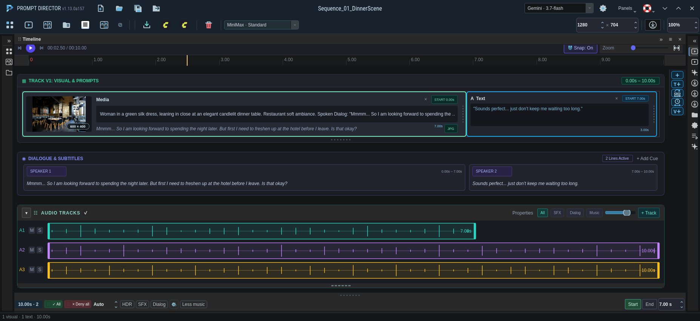
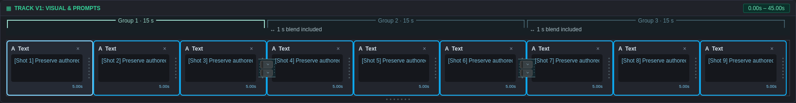

# Studio timeline

Visual media and text prompts share one track. Double-click a dialogue cue to edit the quoted words while preserving the surrounding production prompt. The native prompt panels remain available through Panels.

Play and pause use the existing sequence audio/video transport. The previous and next controls seek to clip boundaries. Snap toggles an eight-pixel magnet for ruler seeks, visual trim handles and audio moves/trims; editing remains frame-aligned. Audio lane M and S controls mute or solo monitoring. All, Dialog, SFX and Music filter the displayed lanes. Properties opens the existing start, end, source-in and track fields.

The right rail adds media or text, rewrites from the combined prompt, re-times the complete sequence and adds a MiniMax continuation. These use the existing experimental controllers and provider/model settings.

Groups retain their own settings, source prompts and render caches. The brackets show each block's duration; transition controls retain blend mode, side and overlap. Existing archive formats, media associations and the text-only FL2VA extension workflow remain supported.
