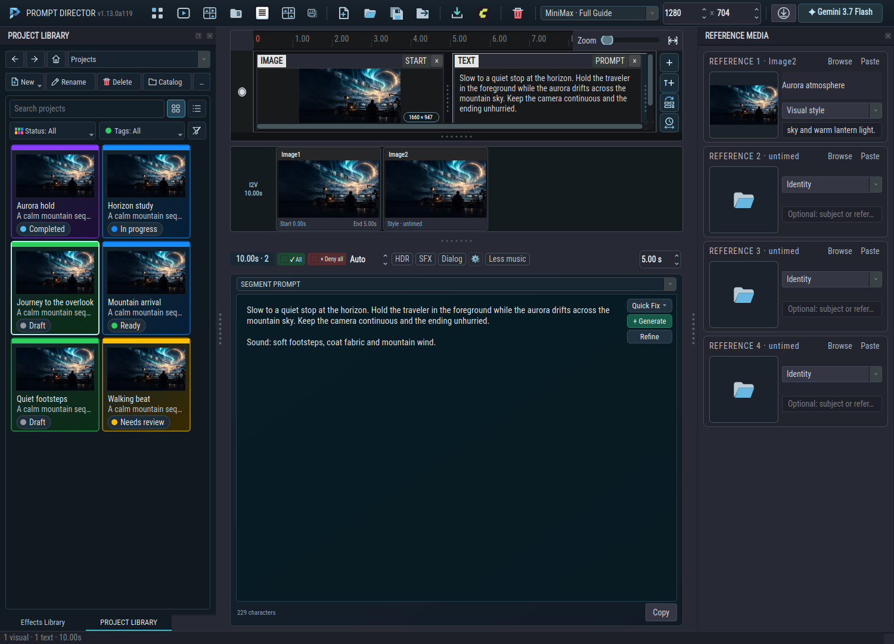
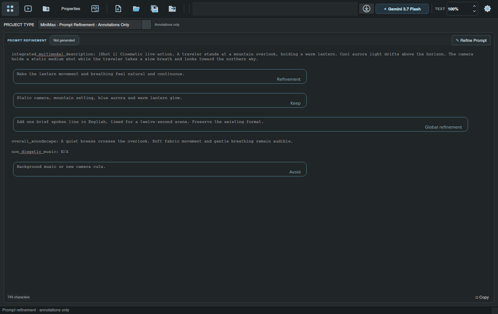
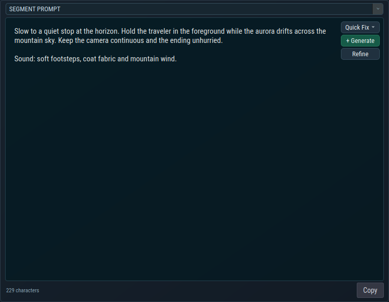
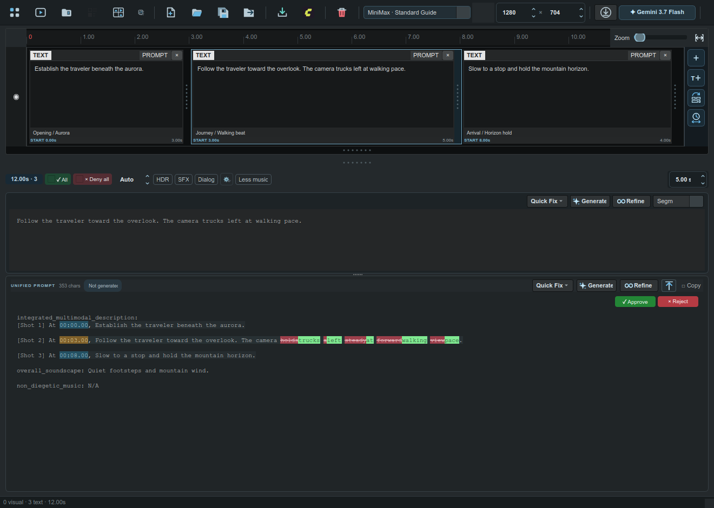
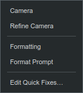
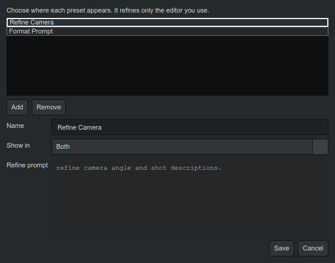
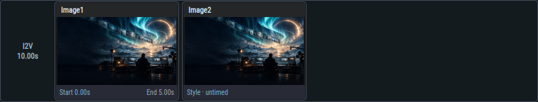

# Direct every segment. Keep the full prompt in view.

All timeline workspaces use one **Unified Prompt** panel. Its scope selector switches between **Segment**, **Global** and **Unified**, keeping each document separate. Select a timeline card to edit that segment, change its frame role or refine its wording and duration. The Prompt Refinement workspace opens its standalone draft in Unified scope.

| Workspace | Production format |
| --- | --- |
| LTX Video | Segment prompts and shared global direction for LTX timeline export |
| MiniMax · Standard Guide | Guide-based integrated description, soundscape and music sections |
| MiniMax · Full Guide | Guide-based subject definitions, summary, retention analysis, detailed description, soundscape and music |
| MiniMax · Standard | Supplied skill conventions for T2VA, I2VA, FL2VA and L2VA, with project variables |
| MiniMax · Full | Supplied six-section reference skill, including companion camera, speech and sound rules |

## Refine a prompt on its own

Choose **MiniMax · Refine** from Project Type. Write or paste a production prompt, then click **Refine**. No media or segments are required. The editor fills the workspace; timeline, conditioning, segment timing, reference media and Director’s Intent controls are hidden.

Type `/` and use the existing annotation suggestions: `/refine` edits a nearby passage, `/refine-global` applies across the prompt, `/keep` protects a detail, `/avoid` excludes a detail and `/focus` adds emphasis. These remain editable note boxes, with the same completion and spelling features as the other prompt editors. A leading `/refine` note before the scene applies to the full prompt unless it identifies a narrower target. Completed global refinement notes are removed after a successful revision; other annotations remain. If the model returns the production text unchanged, the editor keeps your draft and annotations and reports **no text changes**.

Refinement uses only your current prompt and its inline annotations. It preserves the existing MiniMax format, stated timing, identities, dialogue and audio direction unless you request a change. Use **Copy** to take the result into your generation workflow. Save and reopen it as a normal project; each workspace keeps its own draft. Switching back to a timeline workspace restores its segment controls and draft.

## Edit the beats, then develop the full prompt

Choose a scope from the compact controls inside the prompt panel:

| Scope | What you edit and generate |
| --- | --- |
| Segment | The selected timeline beat only |
| Global | Director's Intent for the entire sequence; Generate/Refine acts on all beats and then rebuilds the MiniMax production draft |
| Unified | The independent production text; MiniMax uses the selected template, while LTX uses its shared global production prompt |

The same Quick Fix, Generate and Refine controls follow the selected scope. Unified Generate rebuilds from all current segments and reference roles. Unified Refine changes the production text without rewriting the timeline. **Copy** copies the active document. The timing overview and its resize handle remain above the panel.

The header chevron hides or reopens the prompt body. That view preference is remembered, while the timing overview remains available.

Switching scope preserves your drafts. Pasting or editing Unified text does not change the timeline. Manual timing edits update recognized MiniMax timecodes locally. Segment wording reaches the production draft through an explicit Generate/Refine or synchronization action.

MiniMax gives each recognized shot passage a soft highlight. Its boundary starts
at the timecode (or the first shot's untimed text) and ends before the next
`[Shot N]` label. Blank lines between shots and the sound/music sections stay
outside the highlight.

Generate and Refine include a timecode on the first shot, including when
refining an older untimed draft. A first start frame uses `00:00.00`; a first
end frame uses its segment end time, such as `00:03.00` for a three-second
segment. Prompt-only refinement preserves an existing opening timecode.
Older untimed first shots remain editable in saved projects.

While you type in a selected segment's prompt box, the unified editor scrolls
to that passage and previews its wording changes in red and green. **Approve**
keeps the change in that passage only; **Reject** keeps the original unified
text. Clicking away from the segment editor also rejects an unapproved
preview. Your segment edit stays saved either way. The shot label, timecode,
comma/space separators, other shots and their spacing stay intact. These edits
run locally without an AI request.

The **Generate** button in **Unified** scope rebuilds the production brief from every current
timeline segment, including newly split or inserted beats. Current segment
actions, order and timing take precedence over conflicting older global notes;
beats that share an image still retain their separate action progression.
It transfers segment content one for one, retaining wording wherever possible
while adapting section placement, references, dialogue markup and timing to the
workspace format. Complete action, appearance, dialogue and sound details take
priority over length targets. There is no 350–500-word compression target;
the production description grows with the source material. A response that the
provider marks as truncated is rejected rather than saved as complete.
Across workspace Generate and Refine instructions, word and sentence targets
are soft guidance: preserving details wins. Refinement keeps content outside
your requested edits; an explicit request to shorten or remove content still
authorizes that change.
If the timeline changes while generation is running, the app keeps your draft
and asks you to generate again from the updated sequence.

## Apply a saved Quick Fix

Use **Quick Fix** beside Generate inside the active prompt panel. A preset's
**Show in** setting controls menu availability: **Segment** lists it in the
segment menu, **Unified** lists it in the unified menu, and **Both** lists it in
both. Selecting a preset always refines only the editor whose button you used.
The segment button inserts the instruction at the bottom of the selected
segment; the unified button inserts it at the top of the production prompt.
The result uses that editor's normal inline approve/reject controls.

The included **Refine Camera** preset is available in Both menus with “refine
camera angle and shot descriptions.” **Format Prompt** is available in Unified
with “Format the spacing between shots to make it more human legable”. Choose
**Effects Library…** to browse catalog artwork, add your own effects and edit presets. Set **Apply to** for Segment, Unified or Both, and enable **Show in menu** for the actions you want in Quick Fix. Imported effects keep this option off until you enable it. Presets are saved in your app settings. An empty editor disables its
menu options; content in the other editor is not required.

Set **Category** in the preset editor to group related fixes. The menu shows
category labels with separators between groups. Matching category names share
one group, and only categories with actions available in that editor appear.
Existing presets without a category use **General**. New installations include
**Refine Camera** under **Camera** and **Format Prompt** under **Formatting**.

## Apply a production brief to the timeline

In **Unified** scope, **Generate** and **Refine** edit only the production text. To apply a MiniMax brief to your sequence, click **Rewrite timeline from combined prompt** in the timeline’s right-hand rail, below **＋** and **T＋**. It aligns segment wording and timing to the complete brief and presents the timeline changes for review. Your combined prompt stays unchanged.

## Adjust timing through the shared editor

**Refine** in **Segment** scope improves the selected beat and can resize that segment when its action or dialogue needs a different duration. **Refine Timing** changes its duration while preserving its wording. Other segments and the combined production text remain unchanged.

Select **Global** in the prompt panel to edit shared direction. Add an instruction such as `/refine-global Resize the segments proportionally to 15 seconds`, then choose **Refine**. Director scales the current segment durations to the requested total while preserving their proportions and individual prompt text. Other explicit global timing edits can change multiple segment durations. In MiniMax, the unified production prompt is then generated from the updated sequence. Manual segment edits preserve the draft's prose; recognized timecodes follow manual timing and Start/End frame-mode changes locally. Clicking a segment highlights its code and places the unified cursor immediately after it. See [live timecodes](media-and-timeline.md#make-timing-tangible) for supported formats and incomplete drafts.

## Direct motion through frame anchors

A **Start** frame defines the state at the beginning of its segment; motion
continues from that state toward the following visual anchor. An **End** frame
defines the target at the end of its segment; preceding motion must reach it.
Generate and Refine compare the surrounding timeline visuals and their actual
anchor times, including images separated by text-only beats. Camera direction
uses changes in viewpoint, background landmarks and subject placement together;
a subject moving left does not by itself imply a left pan. Untimed references
retain their selected roles rather than becoming timeline endpoints.

## Check conditioning at a glance

The strip under the MiniMax timeline shows large image previews, with each shot’s timeline **Start** and **End** times together in a shaded bottom row. Video tiles show their timeline range too; source trim ranges and MiniMaxCondFrame values remain in tooltips. Untimed references show their roles. Drag the dotted handle below the strip to resize it, or double-click to hide and reopen it. The previews expand with the panel. The strip flags an opening that needs to move to zero or an ending that needs to reach the sequence total. It describes your setup; it does not move media automatically.

Both MiniMax templates receive `${workflow_name}` and `${workflow_direction}` from the current asset setup, including I2V, FL2V and last-frame L2V. Asset labels, subjects and speakers remain distinct. Dialogue requests can add original spoken lines when none are supplied.

## Keep your direction and drafts

**Director’s Intent** is available in **Global** scope. Prompt options and inline refinement notes remain available across timeline workspaces. Prompt Refinement uses only its standalone prompt and annotations. Switching scope or workspace does not submit an AI request. Projects retain segment prompts, global direction and each workspace’s production draft. Existing review, copy, synchronization and media tools remain available.

**Continue:** [Reference images](minimax-references.md) · [Custom workspaces and exports](workspace-definitions-and-exports.md) · [Complete feature guide](../usage.md)

The Official Skill variants are additional defaults. They receive the detected workflow, duration, asset map, Director’s Intent, global direction, sound/dialogue/music options, and current prompt and instructions during refinement. Their worked-example subjects and timings are format illustrations, never preset content for your scene.

For two end-frame segments lasting 3.0 and 7.5 seconds, the condition values are **3.0** and **10.5**. End frames use the cumulative segment ending time; start frames use the cumulative segment starting time. These are absolute target-video times, not each segment’s duration or a frame count. The strip is a setup guide; it does not modify external ComfyUI nodes.
