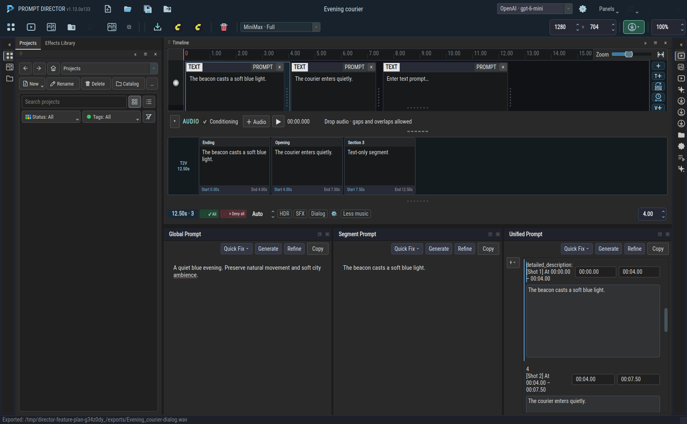
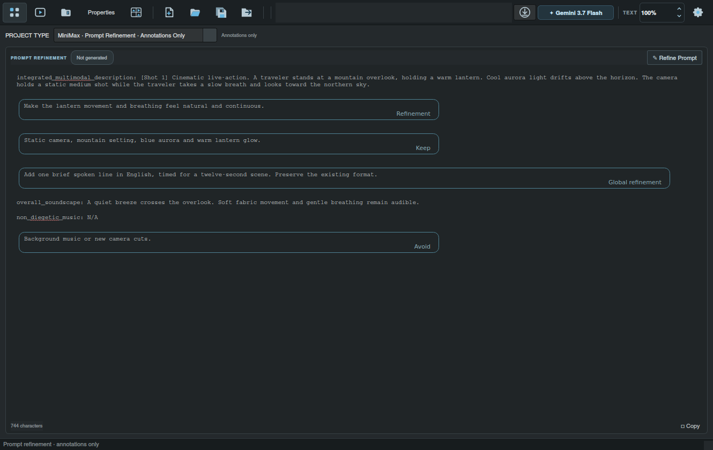
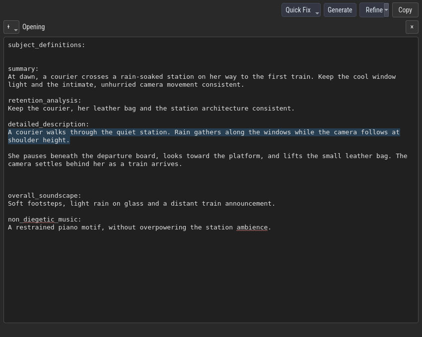
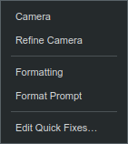
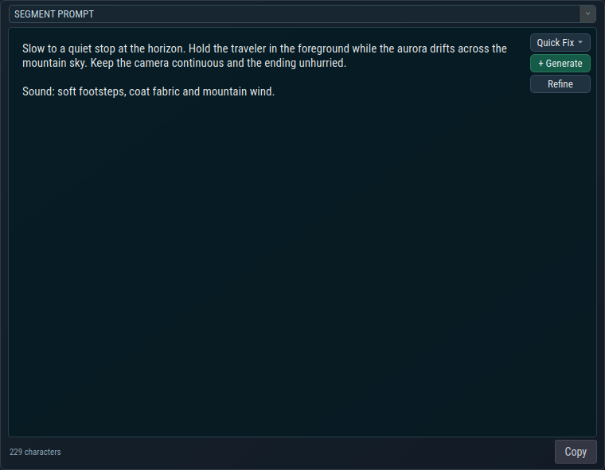
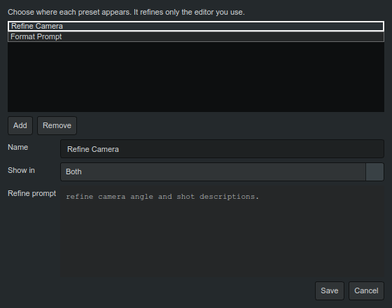
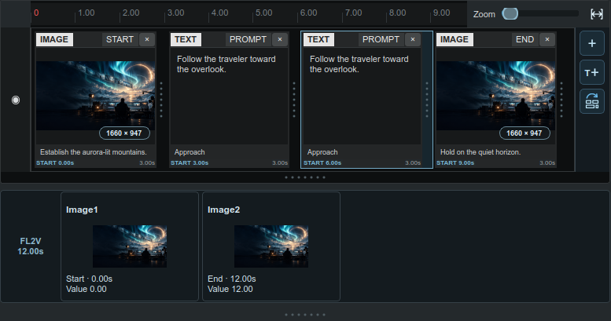
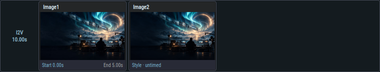

# Direct every segment. Keep the full prompt in view.

Global and Segment are independent dockable panels. MiniMax additionally offers Unified Prompt; LTX does not use a unified prompt. Open them through **Panels** in the header and arrange them around your timeline. [Define your output layout and generate audio](prompt-panels-templates-and-audio.md).

| Workspace | Production format |
| --- | --- |
| LTX Video | Segment prompts and shared global direction for LTX timeline export |
| MiniMax · Standard | Supplied skill conventions for T2VA, I2VA, FL2VA and L2VA, with project variables |
| MiniMax · Full | Supplied six-section reference skill, including companion camera, speech and sound rules |

## Refine a prompt on its own

Choose **Generic Prompt Refine** from Project Type. Write or paste a production prompt, then click **Refine**. No media or segments are required. The editor fills the workspace; timeline, conditioning, segment timing, reference media and Director’s Intent controls are hidden.

Type `/` and use the existing annotation suggestions: `/refine` edits a nearby passage, `/refine-global` applies across the prompt, `/keep` protects a detail, `/avoid` excludes a detail and `/focus` adds emphasis. These remain editable note boxes, with the same completion and spelling features as the other prompt editors. A leading `/refine` note before the scene applies to the full prompt unless it identifies a narrower target. Completed global refinement notes are removed after a successful revision; other annotations remain. If the model returns the production text unchanged, the editor keeps your draft and annotations and reports **no text changes**.

Refinement uses only your current prompt and its inline annotations. It preserves the supplied prompt's format and model conventions unless you request a change. Use **Copy** to take the result into your generation workflow. Save and reopen it as a normal project; each workspace keeps its own draft. Switching back to a timeline workspace restores its segment controls and draft.

## Edit the beats, then develop the full prompt

Use the Segment panel for the selected timeline entry and Global for the entire sequence. Each panel has its own Generate and Refine controls. Unified follows the full document layout saved under **Settings → Workspaces → Workspace templates**.

Unified uses one continuous text area and one scrollbar. Typing in Segment updates its corresponding Unified section locally. Reordering a segment moves that section. Click any timeline entry to highlight and reveal its Unified section, including clicking the selected entry again after scrolling away.

The template defines the headings, spacing and section order. Edit the prompt content in Unified; fixed headings, timestamps and separators remain protected, but can be selected and copied. The toolbar follows the section selected by your cursor or timeline: use its Start/End fields when the template includes timing, or **×** to remove the selected timeline section or definition. **+** adds a timeline section, subject definition or media reference. Spelling suggestions and inline refinement review stay in the same editor.

Generate and Refine fill explicitly named template variables. Complete authored action, appearance, dialogue and sound details take priority over word-count guidance. Prompt-only refinement retains its standalone editor and annotations.

## Apply a saved Quick Fix

Use **Quick Fix** beside Generate inside the active prompt panel. A preset's
**Show in** setting controls menu availability: **Segment** lists it in the
segment menu, **Unified** lists it in the unified menu, and **Both** lists it in
both. Selecting a preset always refines only the editor whose button you used.
The segment button inserts the instruction at the bottom of the selected
segment; the unified button inserts it at the top of the production prompt.
The result uses that editor's normal inline approve/reject controls.

The included **Refine Camera** preset is available in Both menus with “refine
camera angle and shot descriptions.” **Format Prompt** is available in Unified
with “Format the spacing between shots to make it more human legable”. Choose
**Effects Library…** to browse catalog artwork, add your own effects and edit presets. Set **Apply to** for Segment, Unified or Both, and enable **Show in menu** for the actions you want in Quick Fix. Imported effects keep this option off until you enable it. Presets are saved in your app settings. An empty editor disables its
menu options; content in the other editor is not required.

Set **Category** in the preset editor to group related fixes. The menu shows
category labels with separators between groups. Matching category names share
one group, and only categories with actions available in that editor appear.
Existing presets without a category use **General**. New installations include
**Refine Camera** under **Camera** and **Format Prompt** under **Formatting**.

## Apply a production brief to the timeline

In the **Unified** panel, **Generate** and **Refine** edit only the production text. To apply a MiniMax brief to your sequence, click **Rewrite timeline from combined prompt** in the timeline’s right-hand rail, below **＋** and **T＋**. It aligns segment wording and timing to the complete brief and presents the timeline changes for review. Your combined prompt stays unchanged.

## Adjust timing through the shared editor

**Refine** in **Segment** scope improves the selected beat and can resize that segment when its action or dialogue needs a different duration. **Refine Timing** changes its duration while preserving its wording. Other segments and the combined production text remain unchanged.

Select **Global** in the prompt panel to edit shared direction. Add an instruction such as `/refine-global Resize the segments proportionally to 15 seconds`, then choose **Refine**. Director scales the current segment durations to the requested total while preserving their proportions and individual prompt text. Other explicit global timing edits can change multiple segment durations. In MiniMax, the unified production prompt is then generated from the updated sequence. Manual segment edits preserve the draft's prose; recognized timecodes follow manual timing and Start/End frame-mode changes locally. Clicking a segment highlights its code and places the unified cursor immediately after it. See [live timecodes](media-and-timeline.md#make-timing-tangible) for supported formats and incomplete drafts.

## Direct motion through frame anchors

A **Start** frame defines the state at the beginning of its segment; motion
continues from that state toward the following visual anchor. An **End** frame
defines the target at the end of its segment; preceding motion must reach it.
Generate and Refine compare the surrounding timeline visuals and their actual
anchor times, including images separated by text-only beats. Camera direction
uses changes in viewpoint, background landmarks and subject placement together;
a subject moving left does not by itself imply a left pan. Untimed references
retain their selected roles rather than becoming timeline endpoints.

## Check conditioning at a glance

The strip under the MiniMax timeline shows large image previews, with each shot’s timeline **Start** and **End** times together in a shaded bottom row. Video tiles show their timeline range too; source trim ranges and MiniMaxCondFrame values remain in tooltips. Untimed references show their roles. Drag the dotted handle below the strip to resize it, or double-click to hide and reopen it. The previews expand with the panel. The strip flags an opening that needs to move to zero or an ending that needs to reach the sequence total. It describes your setup; it does not move media automatically.

Both MiniMax templates receive `${workflow_name}` and `${workflow_direction}` from the current asset setup, including I2V, FL2V and last-frame L2V. Asset labels, subjects and speakers remain distinct. Dialogue requests can add original spoken lines when none are supplied.

## Keep your direction and drafts

**Director’s Intent** is available in **Global** scope. Prompt options and inline refinement notes remain available across timeline workspaces. Prompt Refinement uses only its standalone prompt and annotations. Switching scope or workspace does not submit an AI request. Projects retain segment prompts, global direction and each workspace’s production draft. Existing review, copy, synchronization and media tools remain available.

**Continue:** [Reference images](minimax-references.md) · [Custom workspaces and exports](workspace-definitions-and-exports.md) · [Complete feature guide](../usage.md)

The Official Skill variants are additional defaults. They receive the detected workflow, duration, asset map, Director’s Intent, global direction, sound/dialogue/music options, and current prompt and instructions during refinement. Their worked-example subjects and timings are format illustrations, never preset content for your scene.

For two end-frame segments lasting 3.0 and 7.5 seconds, the condition values are **3.0** and **10.5**. End frames use the cumulative segment ending time; start frames use the cumulative segment starting time. These are absolute target-video times, not each segment’s duration or a frame count. The strip is a setup guide; it does not modify external ComfyUI nodes.
