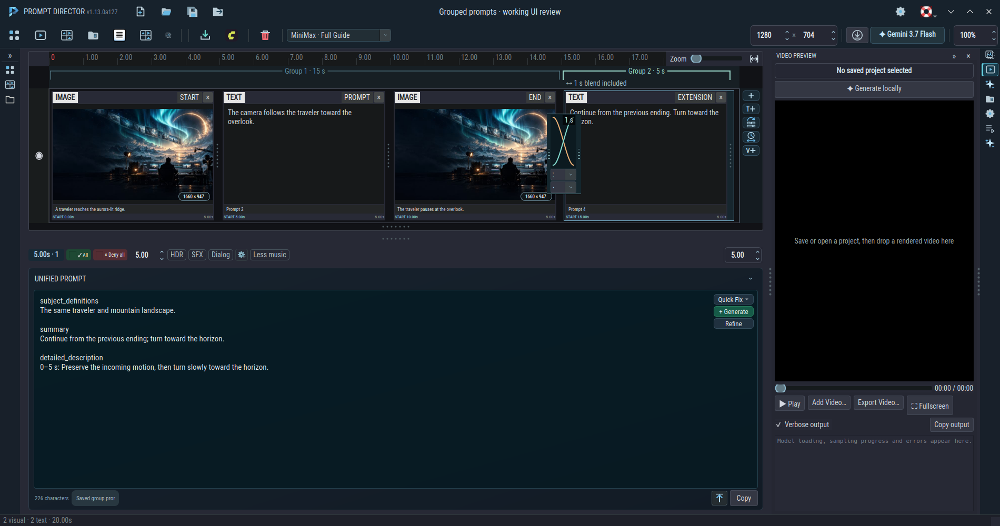
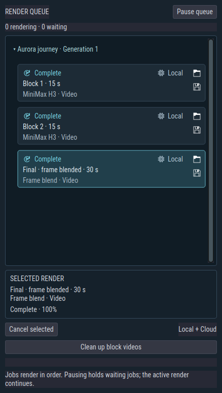
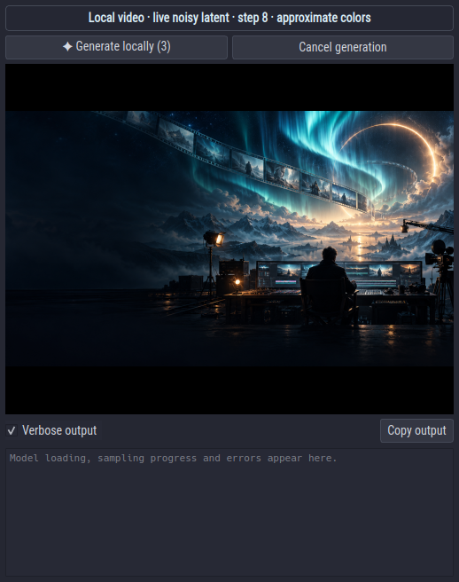
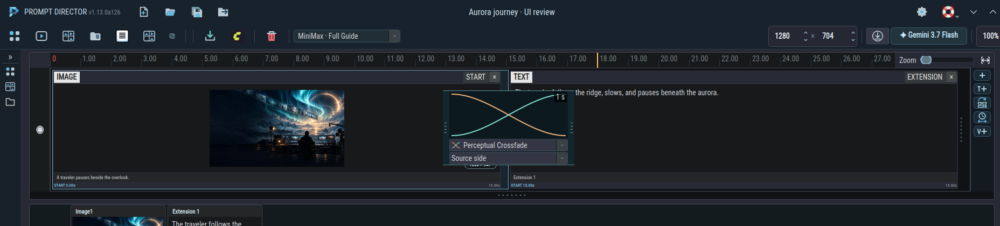
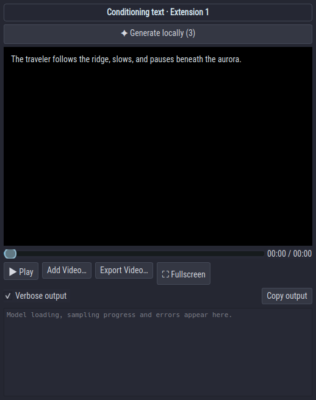

# Continue a MiniMax video

Use **V＋** on the timeline rail to add a continuation. Each continuation group is one video block. Select a segment in a group and use the existing length control to set that block's duration, from 4 to 15 seconds for the local H3 engine. **Auto** uses the group's segment lengths.

One mix box connects each pair of blocks. Drag either edge to change its length; both edges move equally so the box stays centered on the join, inside the visible media area with 10 pixels of clearance at the top and bottom; its mode and side controls stay inside that same box. Choose **Hard cut**, **Linear blend**, **Filmic crossfade**, or **Perceptual crossfade**. The icon and curve show the selected type. Source-side or destination-side overlap controls determine which block contains the composited frames. Visual segments show edge images; text sequences show the curve alone. After rendering, visual segments can show the rendered block's edge frames.

Blends are included in the marked durations. Two 15-second blocks make 30 seconds; blocks marked 10, 5, and 5 seconds make 20 seconds. Changing a blend does not rewrite the production prompt.

Choose the **Ref2VA** checkpoint in local model settings. **Generate locally** renders the first block, then conditions each continuation at time zero using the preceding block's trailing second. The final assembly uses the chosen blends and the sequence editor's blend algorithms. Completed blocks are reused while their group, production settings, references and incoming video stay unchanged. Editing a later group keeps earlier completed blocks; changing a blend only rebuilds the final assembly. Block videos remain available until you clean them up.

## Review and organize renders

Each generation expands into its block jobs and final assembled video. Click its group heading to collapse or expand it. Pause the queue to hold waiting jobs. Cancelling a generation stops its remaining blocks and assembly.

The folder icon at a tile's top right reveals its output file. The export icon beneath it saves a copy. Drag a completed tile to copy its output into a file manager or another application. **Clean up block videos** removes the selected generation's intermediate videos after its final video exists; the final video is kept. Deleting block videos removes their reusable outputs, so the next build must render those blocks again.

Click **Generate locally** again to queue another independent generation of the current project. The button shows the next generation number.

While the selected project is rendering, playback, seek, add-video, export, and fullscreen controls are hidden. Other projects retain their controls. Returning to a project restores its most recent latent preview or final video. The video surface and idle preview background are black.

## Combine projects from a collection

Inside a collection, Ctrl-click projects, then right-click and choose **Group selected projects**. The new prompt project follows the displayed sort order. Three prompts in one source project and one in another remain four editable cards, inside two group brackets, with one blend between the groups. You can group projects before rendering them.

Click a group bracket or one of its segments to load its values into the **existing bottom controls and prompt editor**. The length, options, original Unified Prompt, workflow type and references belong to that group. There are no separate group tabs or settings panels. Original segment prompts, images and video trims remain editable; source projects are retained independently. Moving or resaving the combined `.LTXD` keeps its source media and references portable.

**Collection previews** inside the separate **Shot Sequence** workspace continues to import completed movies in the collection's displayed order.

## Scrub the timeline

Drag across the existing time ruler to preview the sequence without changing the selected segment or its prompt. Available rendered footage auditions its video and audio. If the sequence has no final render at that position, an available rendered block can be previewed; otherwise the panel follows the text, image or trimmed video conditioning segment under the scrub position.

Scrubbing a rendered video uses brief audio samples and preserves whether playback was paused or playing. Conditioning-video previews seek to the source trim without audio. Switching projects discards obsolete preview work. Long source text stays within the preview panel and can be scrolled.

The audio conditioning panel uses the same preview: its ruler seeks the relevant condition or rendered footage, and its Play button advances the preview with the audio strips. Pausing stops both. When conditioning strips supply the audition sound, rendered preview audio is muted during playback to avoid playing both soundtracks; its previous mute setting is restored afterward.

Video analysis and local generation use the selected source trim. Uploaded analysis clips and sampled storyboard frames exclude footage before source-in and after source-out. Original video files remain unchanged.
