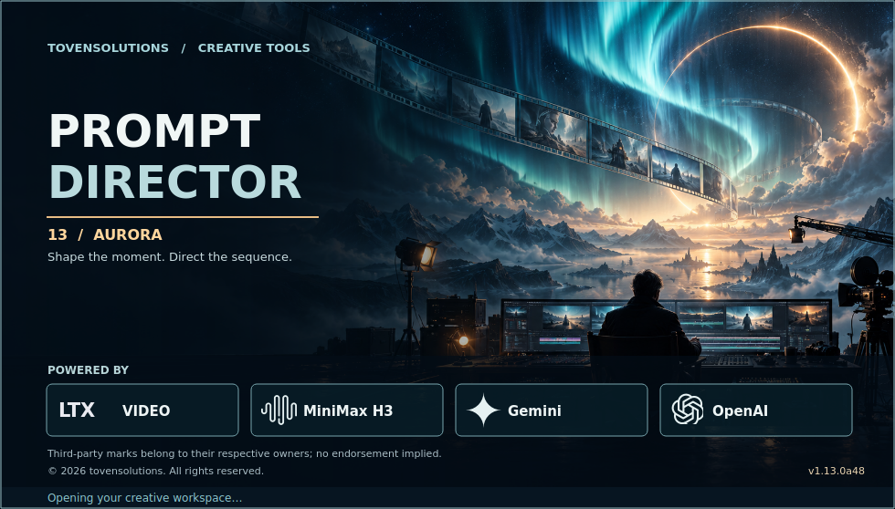
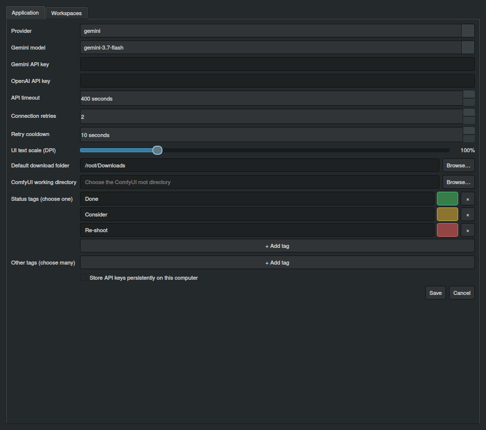

# Start directing with Prompt Director.

## Your desktop workspace for AI video planning

Install Prompt Director, open a project and start arranging your sequence. Timeline editing and project organization work locally. Connect Gemini, OpenAI API, or your eligible ChatGPT plan when you want help generating or refining prompts.



## Install the current experimental build

You need **Python 3.10 or newer** and a desktop environment supported by Qt 6. A virtual environment keeps Director’s dependencies separate from other Python applications.

### Linux and macOS

```bash
python3 -m venv ~/.venvs/ltx-director
source ~/.venvs/ltx-director/bin/activate
python -m pip install --upgrade pip
python -m pip install --upgrade 'https://raw.githubusercontent.com/etoven/ltx-director-director/experimental/dist/ltx_prompt_director-1.13.0a89-py3-none-any.whl'
prompt-director
```

### Windows PowerShell

```powershell
py -m venv "$env:USERPROFILE\ltx-director-venv"
& "$env:USERPROFILE\ltx-director-venv\Scripts\Activate.ps1"
python -m pip install --upgrade pip
python -m pip install --upgrade 'https://raw.githubusercontent.com/etoven/ltx-director-director/experimental/dist/ltx_prompt_director-1.13.0a89-py3-none-any.whl'
prompt-director
```

On first launch, Prompt Director migrates preferences, custom workspaces, projects and managed media from the previous LTX Director folders. Existing files in the new folders take priority, and the original folders are retained.

The package installs Qt components, image handling and the bundled FFmpeg helper. Review-video playback also depends on codec availability on the system.

## Connect your prompt-writing provider

Open **Settings → Application** to choose **Gemini**, **OpenAI**, or **chatgpt**. Gemini and OpenAI API use their existing API keys. For ChatGPT-plan authentication, open the new **ChatGPT plan** tab, select **Continue with ChatGPT**, approve plan usage in your browser, then choose a model from your account-specific model catalog. Return to the Application tab to select the **chatgpt** provider. No API key is required for the ChatGPT-plan route. Set the request timeout, additional retry attempts and cooldown to fit your provider.



API keys can be retained for the session or stored through the app’s persistent-key option. Use persistent storage on a computer you trust. Keys are excluded from portable project exports. AI requests send the selected project context to the provider; local editing and project storage do not require an AI call.

## Set up your working space

Set a default download folder for exports and a ComfyUI working directory for LTX JSON handoff. Customize status tags and other labels. Adjust text scale from 75% to 200%, either here or from the main toolbar. Open **Workspaces** when you want to customize prompt layouts and master instructions.

On Linux, the first launch installs an application-menu shortcut for the current installation. Refresh it manually with:

```bash
prompt-director-install-desktop
```

Remove that shortcut with `prompt-director-uninstall-desktop`. Keep the virtual environment in place while its launcher is in use.

## Run from source

```bash
git clone --branch experimental https://github.com/etoven/ltx-director-director.git
cd ltx-director-director
python3 -m venv .venv
source .venv/bin/activate
python -m pip install --upgrade pip
python -m pip install .
prompt-director
```

On Windows, use `py -m venv .venv` and activate `.venv\Scripts\Activate.ps1`. Use the `main` branch for the stable line and `experimental` for Aurora development.

## When a desktop dependency needs attention

On Ubuntu or Debian, an error naming a missing XCB component can be resolved with `sudo apt install libxcb-cursor0 libxkbcommon-x11-0`. If the named missing library is `libEGL.so.1`, install `libegl1`.

For inline spelling suggestions, install an Enchant provider and a dictionary for your language. The editors remain usable without a matching dictionary.

If startup reports missing PySide6 modules, activate the environment used to run Director and reinstall the wheel with `python -m pip install --force-reinstall` followed by the wheel URL above. For a provider error, check the selected model, API key, quota and connection in Settings.

**Ready for the first sequence? [Open the complete feature and usage guide →](usage.md)**

## ChatGPT plan OAuth

The ChatGPT-plan provider is for eligible Plus/Pro accounts on locally installed open-source clients. Requests are made to the official Responses API with `store=false` and `stream=true`, using a model listed for your authenticated account. The app stores its account tokens in `~/.config/PromptDirector/chatgpt-oauth.json` (owner-only permissions on Unix), separate from project exports and QSettings API keys. You can switch accounts, refresh the live model list, sign out, and manage plan usage in ChatGPT Settings. API-key providers are unchanged. The app's workspace prompts, selected timeline references and images are sent to the selected provider when generating AI content; the ChatGPT sign-in itself does not grant access to your conversation history.

ChatGPT-plan usage is subject to your account limits and selected-model eligibility. If authorization or permissions expire, reconnect from the ChatGPT plan tab. Documentation: https://developers.openai.com/siwc/token-sharing-open-source/sign-in

## Live generation streaming

Every prompt-generation and refinement action now displays the in-progress model output. Magic Build and segment/global refinements use a two-column generation overlay; MiniMax/Generic unified prompts display a collapsible Live AI Activity panel immediately above the editable prompt. The left column shows only provider-published reasoning **summaries** when the model provides them; the right column streams generated prompt text. Both columns have an Auto-scroll control. On retries the stream resets to avoid mixing separate attempts. The finished prompt is applied to the editable project only once the provider response passes its normal validation.

Gemini is streamed through `streamGenerateContent` with `includeThoughts` when accepted. OpenAI API and ChatGPT OAuth use Responses streaming and request `reasoning.summary=auto` when supported. Non-thinking models still stream generated text; unsupported summary options automatically fall back to text-only streaming. Private reasoning and cryptographic thought signatures are never displayed.

## Structured streaming and completed-draft recovery

The Live AI Activity panel decodes JSON prompt content incrementally into readable field cards rather than showing escaped JSON syntax. Custom SVG icons identify reasoning summaries and generated prompt output. Live generated text is presentation-only until the AI response finishes validation.

A completion is fingerprinted using the same provider and model that originally generated it. This fixes false "inputs changed" rejection when ChatGPT OAuth uses a model different from the Gemini default. Genuine concurrent timeline or editor changes preserve the completed prompt in a reviewable state: choose **Use generated result** to apply it explicitly or **Copy generated** to copy it without replacing your edits.

## One contextual AI control and live in-editor diff

Each active prompt editor now displays one contextual **Generate** or **Refine** split-button. Its dropdown exposes the available operations for that workspace: generate timeline prompts, generate unified prompt, refine unified prompt, refine selected segment, refine global direction and refine timing. There are no duplicate visible refine buttons or regenerate controls. The existing actions and worker paths are reused.

Generated prompt text animates *inside the active text box*, with newly arriving text tinted red and removed/replaced passages struck through in muted red. Unchanged lines remain visible as anchors. This temporary diff does not enter project state, and the original QTextDocument/undo history is preserved. On completion or error the original editor document is restored before validating/applying the finished response. When a user begins to edit, inline animation suspends immediately, restores the original editor and yields to the user, with the existing result-conflict recovery available if necessary.

Reasoning summaries and provider progress are displayed in a separate **AI ACTIVITY** Qt dock. The panel can be floated or docked; open it through the primary AI button dropdown. It automatically opens when the selected model publishes a reasoning summary. JSON model output is parsed incrementally so red typing shows decoded prompt prose rather than escape sequences or schema keys. If a model provides no text until completion, the normal validated result application still works.

## GPT-6+ combined segment and unified refinement

Existing workspace creative/production prompts stay intact. For supported GPT-6+ OpenAI API-key or ChatGPT-plan models, and supported Gemini Flash text models, the same Generate/Refine action adds an extra JSON segments array to the ordinary unified prompt response. This is automatic and not an extra button. IDs identify existing media so the plan can propose changes in prompt, duration, frame role, order, inserts, or deletions without inventing physical source files. The revised unified prompt and segment plan are validated together before being applied.

MiniMax and Generic workflows now show only the actual unified text editor, not a second segment prompt box. The timeline toolbar contains the one contextual Generate/Refine button, and the segment/global/unified target selector. The button has no dropdown: mark edits anywhere using `/refine` or `/refine-global`, then click Refine. Prompt-only refinement workspaces keep that same button in the visible editor header. Red in-editor generated-text animation auto-scrolls while editors and timeline edit controls are locked, so no concurrent-edit conflict warning is needed.

Completed segment JSON records preview proposed timeline operations as they stream; the full validated plan commits atomically. New tiles slide into place and expand to their planned duration. When the model's segment JSON requests artwork, the app discovers its configured image tools automatically and shows a one-time cost approval. For ChatGPT OAuth text models, it prefers the separate Gemini API's `gemini-3.1-flash-lite-image` (Nano Banana 2 Lite), then a conventional OpenAI API key where available. Other supported Gemini planning models also use Flash Lite Image. The new tile shows a pulsing generation placeholder while the selected paid image API renders. On success the real PNG replaces the placeholder as a start frame; on failure the proposed segment and image prompt remain with a right-click Retry artwork generation entry. If there is no image API key or the user declines the one-time cost approval, the artwork request remains pending. Automatic image generation is limited to four new images per pass; additional requests wait for manual initiation. ChatGPT-plan OAuth alone never has image generation access. Paid Gemini/OpenAI keys are kept separate; approval is remembered per provider until changed in settings.

The AI activity dock continues to show provider-published reasoning summaries, while project identity checks still prevent stale worker output from overwriting a different project.

## Single-button slash refinement and automatic image tools (1.13.0a81)

Write `/refine` or `/refine-global` in the unified prompt, current segment prompt, director intent, or global direction, and click the only **Refine** button. In unified modes the model returns both the revised production prompt and the appended `segments` JSON for automatic timeline diff/application; there are no separate Generate Timeline or segment-operation actions in a dropdown. Gemini Flash text models can provide this JSON too.

If the returned JSON requests frame artwork, the app automatically uses an available supported image backend. Its default ChatGPT OAuth fallback is the separate paid `gemini-3.1-flash-lite-image` API with a Gemini key; an OpenAI API key is another option. Image generation is **not** included in ChatGPT subscription OAuth. Before the first paid generation with each provider, a one-time approval warning appears. Both approvals and declines are remembered once per provider; declining leaves the artwork tile pending. Right-click a pending tile to explicitly revisit a declined decision. At most four automatic image requests are submitted in a single refinement.

## Director's Intent selector correction (1.13.0a81)

The two-item selector next to the **Director's Intent** text area chooses the **visible editor contents**, NOT an AI target or separate generation command. Choose **Director's Intent** to edit the persistent overall creative intent, or **Selected Segment** to edit the actual prompt belonging to whichever timeline segment is selected. The selector occupies the same editor position, so there are no additional duplicate prompt boxes. Edits and inline `/refine` annotations are saved on their corresponding segment; changing timeline selection updates the visible text. Switching back preserves the original creative intent and unified production prompt. The one Generate/Refine button remains in the shared timeline controls; refinements always read /refine annotations from all existing prompts and return a unified production prompt and segment JSON together when supported.
