# Effect table - MiniMax segment wording

Generated images illustrate the body region or endpoint; sound entries use conceptual graphics. See `index.html` for Gemini wording, reference playback and filtering.

| Thumbnail | Effect | Segment prompt | Matching constraint |
| --- | --- | --- | --- |
| 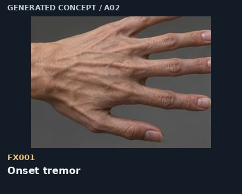 | FX001 - Onset tremor | On <Subject 1>, let a fine localized tremor travel from the fingertips toward the wrist while the hand remains attached and keeps its original pose. End before the limb changes species. Retain the source shot's identity, framing, lighting, background and existing motion outside the selected region. | Use a locked closeup; transfer micro-motion, not the reference actor. |
| 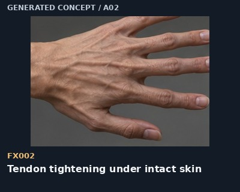 | FX002 - Tendon tightening under intact skin | On <Subject 1>, tighten the visible tendons across the back of the selected hand; the skin draws taut along those tendons and then relaxes slightly, with the wrist position retained. Retain the source shot's identity, framing, lighting, background and existing motion outside the selected region. | Match tendon direction and skin tension; retain five connected digits. |
| 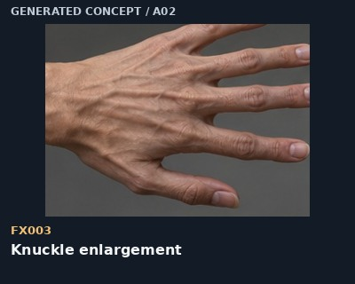 | FX003 - Knuckle enlargement | On <Subject 1>, enlarge the existing knuckles gradually beneath continuous skin, starting at the middle joints and settling into the selected animal-hand proportions. Retain the source shot's identity, framing, lighting, background and existing motion outside the selected region. | Track the original joint centers; do not add joints. |
|  | FX004 - Finger elongation | On <Subject 1>, lengthen the existing fingers from their joints outward as the tendons pull taut; keep each fingertip connected and preserve the hand's grasp. Retain the source shot's identity, framing, lighting, background and existing motion outside the selected region. | Transfer lengthening rhythm only; retain the selected digit topology. |
| 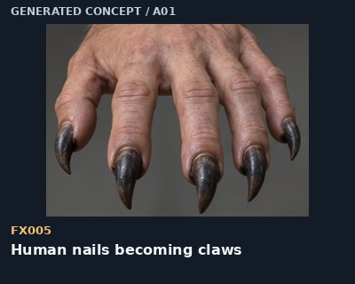 | FX005 - Human nails becoming claws | On <Subject 1>, thicken each existing fingernail from its nail bed into a curved keratin claw, extending continuously along the finger axis before stopping at the requested length. Retain the source shot's identity, framing, lighting, background and existing motion outside the selected region. | Match nail-bed origin; one claw per digit. |
| 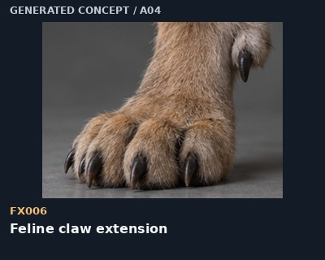 | FX006 - Feline claw extension | On <Subject 1>, extend each claw from its existing retractile sheath as the final toe joint rotates into the selected feline paw pose; keep the main paw still. Retain the source shot's identity, framing, lighting, background and existing motion outside the selected region. | Use this for cats and big cats, not bear claw anatomy. |
| 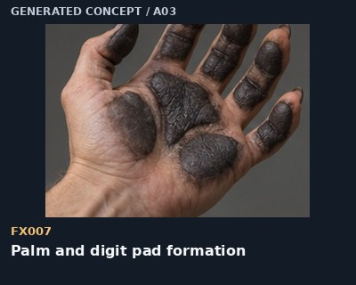 | FX007 - Palm and digit pad formation | On <Subject 1>, thicken the palm and fingertip contact surfaces into dark textured pads, with gradual pigment and surface-volume changes following the existing folds. Retain the source shot's identity, framing, lighting, background and existing motion outside the selected region. | Match underside view and contact points; pad shapes must follow the selected animal. |
| 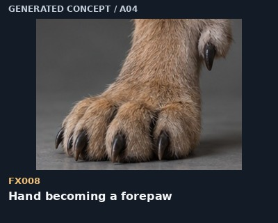 | FX008 - Hand becoming a forepaw | On <Subject 1>, shorten and thicken the selected forward digits, broaden the palm into a paw base, and retain a single continuous wrist connection; follow the chosen species' digit count. Retain the source shot's identity, framing, lighting, background and existing motion outside the selected region. | Choose a digit map before rendering. Do not apply a generic five-toed paw to every animal. |
| 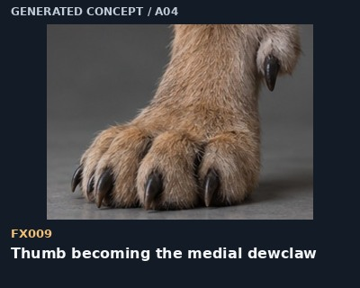 | FX009 - Thumb becoming the medial dewclaw | On <Subject 1>, draw the existing thumb proximally along the inner side of the forepaw into the dewclaw position while the other four toes settle forward. Retain one continuous thumb-to-dewclaw transition. Retain the source shot's identity, framing, lighting, background and existing motion outside the selected region. | For this felid endpoint, transform the thumb, not the pinky; do not sprout a sixth digit. |
| 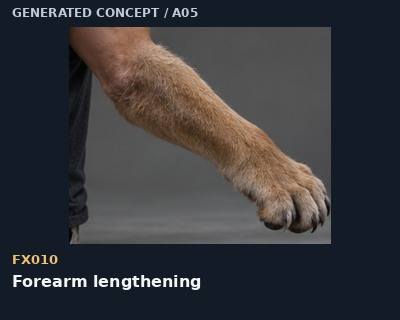 | FX010 - Forearm lengthening | On <Subject 1>, lengthen the forearm between the existing elbow and wrist; the continuous skin and short coat stretch with the limb, then settle to the selected endpoint. Retain the source shot's identity, framing, lighting, background and existing motion outside the selected region. | Hold both joint endpoints in view if possible; preserve volume rather than making a rubber tube. |
| 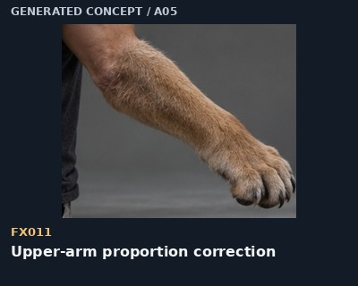 | FX011 - Upper-arm proportion correction | On <Subject 1>, adjust the upper-arm-to-forearm ratio toward the chosen animal while preserving the shoulder and elbow connections; move the existing joints along a continuous anatomical path. Retain the source shot's identity, framing, lighting, background and existing motion outside the selected region. | Use an endpoint reference for that species and pose. A lion forelimb is not a uniformly lengthened human arm. |
| 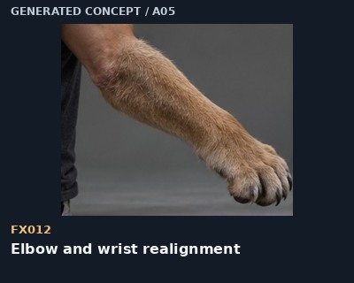 | FX012 - Elbow and wrist realignment | On <Subject 1>, rotate the selected elbow and wrist gradually into the endpoint forelimb alignment, maintaining continuous tendons and the original reach direction. Retain the source shot's identity, framing, lighting, background and existing motion outside the selected region. | Keep one elbow and one wrist; avoid adding a false middle hinge. |
| 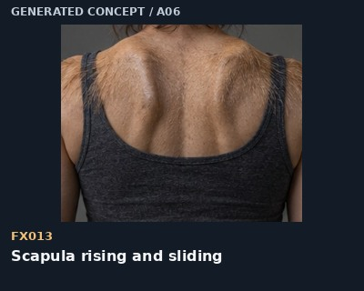 | FX013 - Scapula rising and sliding | On <Subject 1>, slide the existing shoulder blades into a more raised animal shoulder profile beneath continuous back skin and clothing, following the current arm movement. Retain the source shot's identity, framing, lighting, background and existing motion outside the selected region. | Deform the shoulder-blade region; retain a closed chest and one pair of shoulders. |
| 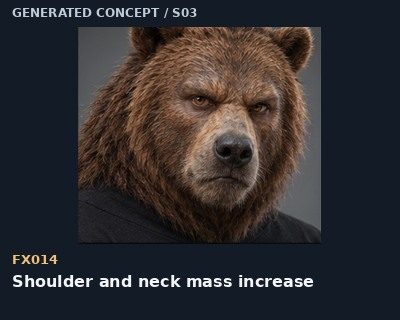 | FX014 - Shoulder and neck mass increase | On <Subject 1>, build shoulder and neck muscle volume gradually under the existing skin and clothing, with weight settling downward after each growth pulse. Retain the source shot's identity, framing, lighting, background and existing motion outside the selected region. | Match a bear or heavy-wolf endpoint; do not scale the head or camera. |
| 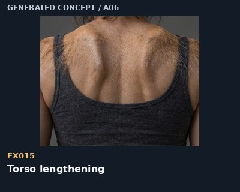 | FX015 - Torso lengthening | On <Subject 1>, increase the distance between the shoulder girdle and pelvis along the existing spine while maintaining a continuous torso silhouette and coherent cloth tension. Retain the source shot's identity, framing, lighting, background and existing motion outside the selected region. | Retain a sealed torso surface; match length to the chosen animal and pose. |
| 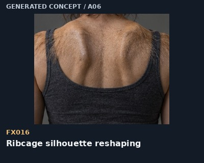 | FX016 - Ribcage silhouette reshaping | On <Subject 1>, reshape the ribcage beneath intact skin into the selected animal's chest depth and width; show the surface and breathing motion without opening the torso. Retain the source shot's identity, framing, lighting, background and existing motion outside the selected region. | Change the outer silhouette, not an exposed internal chest. |
| 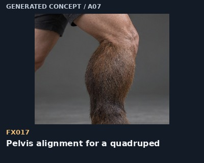 | FX017 - Pelvis alignment for a quadruped | On <Subject 1>, tilt and narrow the visible pelvic silhouette toward the quadruped endpoint as body weight moves through the original hips; retain existing limb attachments. Retain the source shot's identity, framing, lighting, background and existing motion outside the selected region. | Use a covered side view with consistent spine-to-pelvis alignment. |
| 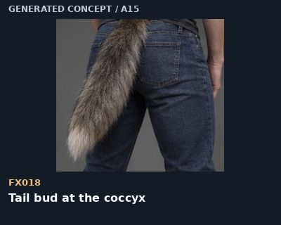 | FX018 - Tail bud at the coccyx | On <Subject 1>, form one small tail bud at the coccyx, pushing the existing rear-waist silhouette outward before any substantial tail extension. Retain the source shot's identity, framing, lighting, background and existing motion outside the selected region. | One midline origin behind the pelvis; no duplicate tail or attachment to the thigh. |
| 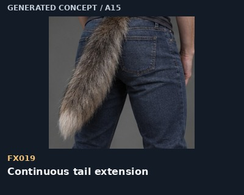 | FX019 - Continuous tail extension | On <Subject 1>, extend the existing tail bud outward from its base in a continuous taper, then let the new tail make a small weight-driven settling motion. Retain the source shot's identity, framing, lighting, background and existing motion outside the selected region. | Match tail type: furred canine, tufted lion, long feline, or hair-covered equine. |
| 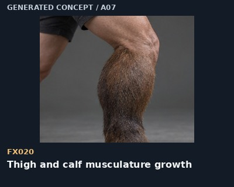 | FX020 - Thigh and calf musculature growth | On <Subject 1>, increase the selected thigh and calf muscle volume beneath intact skin, preserving the knee location and letting clothing stretch along its seams. Retain the source shot's identity, framing, lighting, background and existing motion outside the selected region. | Keep one leg; growth changes mass rather than inflating a spherical bulge. |
| 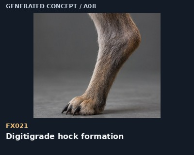 | FX021 - Digitigrade hock formation | On <Subject 1>, raise the heel as the metatarsal region lengthens and the foot transitions onto its toes, forming the rear-facing ankle hock while the knee continues to bend forward. Retain the source shot's identity, framing, lighting, background and existing motion outside the selected region. | The hock is the ankle, not a backward knee. Keep the toe contact anchored. |
| 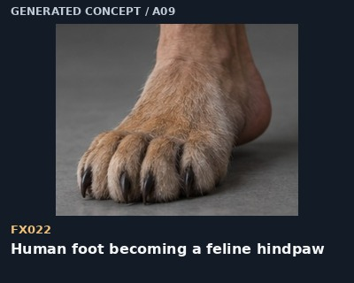 | FX022 - Human foot becoming a feline hindpaw | On <Subject 1>, broaden the selected forefoot into four main feline toes while the redundant fifth toe is smoothly absorbed into the changing foot; keep the heel-to-ankle transition continuous. Retain the source shot's identity, framing, lighting, background and existing motion outside the selected region. | A standard feline hindpaw has four toes; do not copy a forepaw dewclaw onto it. |
|  | FX023 - Bear foot remaining plantigrade | On <Subject 1>, broaden the selected foot into a five-toed bear hindfoot with a wide sole and long claws, keeping the heel grounded through the weight-bearing phase. Retain the source shot's identity, framing, lighting, background and existing motion outside the selected region. | Do not apply a canine digitigrade hock to this bear endpoint. |
| 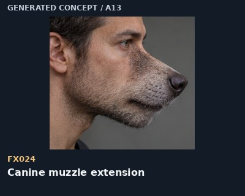 | FX024 - Canine muzzle extension | On <Subject 1>, extend the nose, upper jaw and lower jaw together into a continuous canine muzzle while the lips track the new bite and the original facial expression remains readable. Retain the source shot's identity, framing, lighting, background and existing motion outside the selected region. | Match a profile or three-quarter source; keep nostrils and teeth aligned. Wolf Man 2025 is not the long-muzzle endpoint. |
| 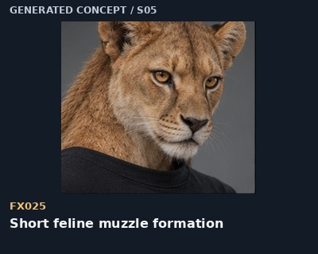 | FX025 - Short feline muzzle formation | On <Subject 1>, broaden the upper lip and whisker pads into a short feline muzzle as the nose advances modestly; the cheeks and lower jaw follow continuously. Retain the source shot's identity, framing, lighting, background and existing motion outside the selected region. | Keep a compact felid profile; avoid a long canine snout. |
| 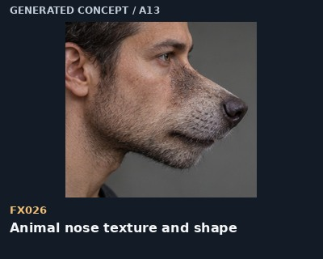 | FX026 - Animal nose texture and shape | On <Subject 1>, reshape the existing nose into the selected animal's nasal surface, widening the nostrils and gradually changing the skin texture and pigment without detaching it from the face. Retain the source shot's identity, framing, lighting, background and existing motion outside the selected region. | Choose canine nose, feline nose, bovine nasal pad or equine nostrils explicitly. |
|  | FX027 - Canine teeth extending within the bite | On <Subject 1>, lengthen the existing canine teeth from their roots while the lips and jaw accommodate the growing bite. Keep one ordered upper and lower dental arcade. Retain the source shot's identity, framing, lighting, background and existing motion outside the selected region. | Match visible gum line and mouth opening; no extra rows for mammal targets. |
| 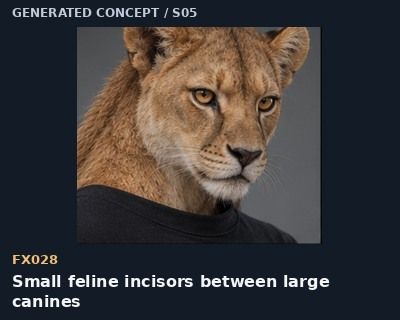 | FX028 - Small feline incisors between large canines | On <Subject 1>, reshape the front incisors into a compact orderly feline row between the larger canine teeth; keep natural warm ivory tone and the existing bite alignment. Retain the source shot's identity, framing, lighting, background and existing motion outside the selected region. | Do not replace every front tooth with a fang or make all teeth uniformly large. |
| 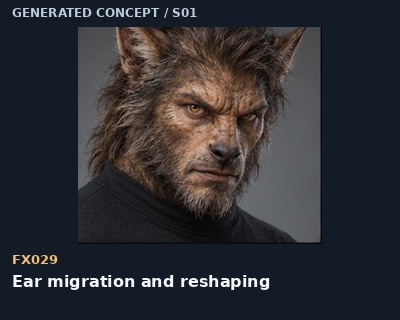 | FX029 - Ear migration and reshaping | On <Subject 1>, move the existing ear bases continuously toward the selected animal position as cartilage reshapes, then grow the appropriate fur or skin texture over the same ears. Retain the source shot's identity, framing, lighting, background and existing motion outside the selected region. | Retain one left and one right ear; remove the old human-ear outlines as the same ears migrate. |
| 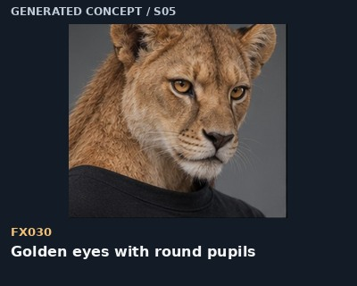 | FX030 - Golden eyes with round pupils | On <Subject 1>, shift the iris toward natural amber-gold while keeping the pupils round, the corneal reflections fixed to the shot lighting and the eyelid anatomy intact. Retain the source shot's identity, framing, lighting, background and existing motion outside the selected region. | Use for wolf, cheetah, lion and tiger endpoints; iris color is not emitted light. |
| 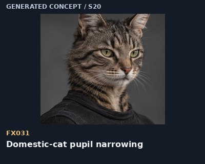 | FX031 - Domestic-cat pupil narrowing | On <Subject 1>, narrow the pupils vertically in response to the shot's brighter illumination while preserving the iris, eye position and catchlights. Retain the source shot's identity, framing, lighting, background and existing motion outside the selected region. | Domestic-cat option; do not apply this automatically to lions, tigers or cheetahs. |
| 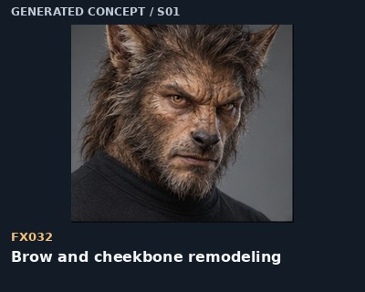 | FX032 - Brow and cheekbone remodeling | On <Subject 1>, remodel the brow and cheek contours gradually under intact skin, maintaining eye spacing and allowing the existing expression to carry through the change. Retain the source shot's identity, framing, lighting, background and existing motion outside the selected region. | Transfer local volume progression rather than replacing the entire face identity. |
| 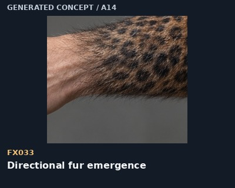 | FX033 - Directional fur emergence | On <Subject 1>, grow fine hairs from the existing skin surface, thicken them into short fur and lay them along the limb's natural coat direction as the skin deforms beneath. Retain the source shot's identity, framing, lighting, background and existing motion outside the selected region. | No fur cloud, haze, floating coat shell or opaque painted dissolve. |
| 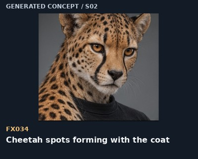 | FX034 - Cheetah spots forming with the coat | On <Subject 1>, develop distinct solid black spots within the growing tawny coat, anchored to the same skin coordinates as the limb changes shape; add facial tear tracks only on the face. Retain the source shot's identity, framing, lighting, background and existing motion outside the selected region. | Spots move with anatomy; do not substitute leopard rosettes. |
| 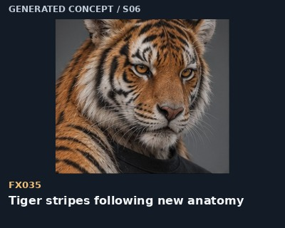 | FX035 - Tiger stripes following new anatomy | On <Subject 1>, develop black tiger stripes within the growing orange coat, wrapping around the changing limb with consistent spacing and coherent continuity across nearby surfaces. Retain the source shot's identity, framing, lighting, background and existing motion outside the selected region. | Retain stripe identity through deformation; do not float markings over the fur. |
| 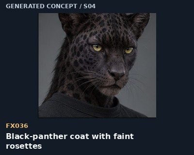 | FX036 - Black-panther coat with faint rosettes | On <Subject 1>, darken the emerging leopard coat toward black while leaving faint rosettes visible under reflected light; retain directional individual hairs and source highlights. Retain the source shot's identity, framing, lighting, background and existing motion outside the selected region. | Use a melanistic leopard endpoint here; do not crush all coat detail to featureless black. |
|  | FX037 - Subsurface structural ripple | On <Subject 1>, send one localized structural ridge along the selected limb beneath continuous skin, then let it settle into the new contour without opening the surface. Retain the source shot's identity, framing, lighting, background and existing motion outside the selected region. | A restrained surface deformation, not exposed bones or a second limb under the skin. |
| 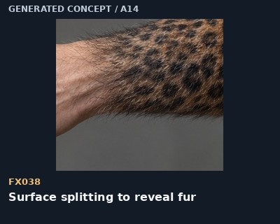 | FX038 - Surface splitting to reveal fur | On <Subject 1>, part one narrow outer skin-like surface seam along the growth direction and reveal dense attached creature fur immediately beneath; the opening closes around the larger formed surface. Retain the source shot's identity, framing, lighting, background and existing motion outside the selected region. | Van Helsing-inspired authored variant: fur fills the opening. Do not create an empty body cavity, detached body part or whole-body peel unless requested. |
| 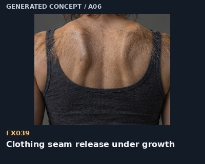 | FX039 - Clothing seam release under growth | On <Subject 1>, stretch the existing garment over the expanding selected region until one stressed seam releases; retain connected fabric folds and the garment's original color and material. Retain the source shot's identity, framing, lighting, background and existing motion outside the selected region. | Tear clothing only where tension justifies it; do not replace the outfit or expose unrelated regions. |
| 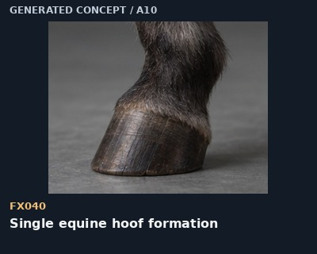 | FX040 - Single equine hoof formation | On <Subject 1>, consolidate the selected distal limb into one load-bearing equine digit and grow a single continuous keratin hoof wall around it, retaining a visible fetlock above. Retain the source shot's identity, framing, lighting, background and existing motion outside the selected region. | One hoof per limb. No cloven seam, cow dewclaws or extra hooves. Choose a front- or hindlimb mapping before applying. |
| 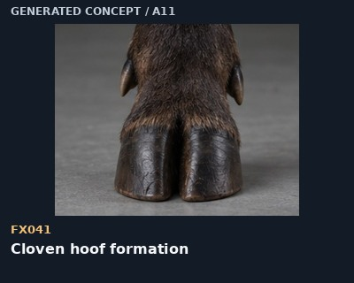 | FX041 - Cloven hoof formation | On <Subject 1>, consolidate the selected distal limb into two principal weight-bearing digits, form a cloven hoof wall around each and retain smaller rear dewclaws according to the chosen species. Retain the source shot's identity, framing, lighting, background and existing motion outside the selected region. | A bovine, caprine or cervid topology; do not leave five human fingertips inside the final hoof. |
| 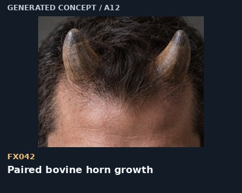 | FX042 - Paired bovine horn growth | On <Subject 1>, raise one symmetric pair of horn buds from the frontal region behind the eye line and extend each as a tapering unbranched keratin horn; move surrounding skin and hair coherently. Retain the source shot's identity, framing, lighting, background and existing motion outside the selected region. | Match the chosen bull or cow phenotype. Horns curve without splitting into antler branches. |
| 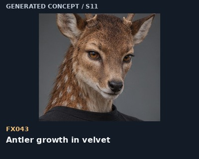 | FX043 - Antler growth in velvet | On <Subject 1>, extend a matched pair of antler beams from the existing pedicles, developing the chosen branch pattern under a soft velvet surface while retaining head scale. Retain the source shot's identity, framing, lighting, background and existing motion outside the selected region. | This is a fantasy time-compressed growth segment. Do not mix velvet antlers with polished permanent bovine horns. |
|  | FX044 - Beak emerging from the midface | On <Subject 1>, reshape the nose and lip-jaw contours into one aligned upper and lower beak, growing the keratin surface continuously while preserving the bite hinge. Retain the source shot's identity, framing, lighting, background and existing motion outside the selected region. | Choose raven-straight or raptor-hooked form; do not add a beak in front of an intact human mouth. |
| 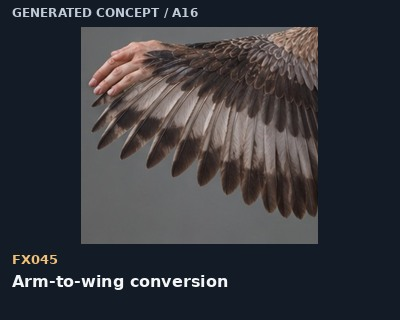 | FX045 - Arm-to-wing conversion | On <Subject 1>, reshape the existing arm into the selected bird wing, reduce and integrate the hand into the distal wing structure and unfold the wing along the original shoulder connection. Retain the source shot's identity, framing, lighting, background and existing motion outside the selected region. | One arm becomes one wing. Do not retain a full hand and add another wing beside it. |
| 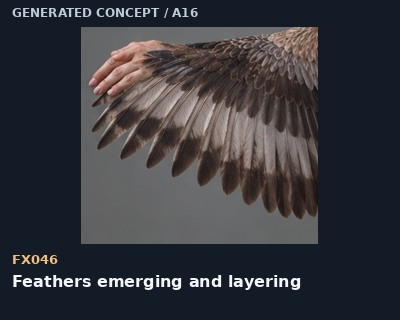 | FX046 - Feathers emerging and layering | On <Subject 1>, raise short feather shafts along the selected tract, unfold vanes and lay the feathers in overlapping rows that follow the changing surface. Retain the source shot's identity, framing, lighting, background and existing motion outside the selected region. | Distinguish contour feathers from long flight feathers; avoid a furry feather cloud. |
|  | FX047 - Bat wing membrane tensioning | On <Subject 1>, lengthen fingers II through V and tension a thin continuous membrane between them while keeping the thumb free and the wing connected to the existing arm. Retain the source shot's identity, framing, lighting, background and existing motion outside the selected region. | Use mammalian bat-wing fingers, not bird feathers or an extra shoulder pair. |
| 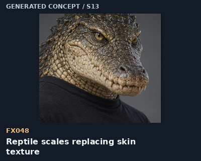 | FX048 - Reptile scales replacing skin texture | On <Subject 1>, raise a coherent pattern of small scales within the selected skin surface, deepen the seams between scales and let the pattern stretch with the new limb contour. Retain the source shot's identity, framing, lighting, background and existing motion outside the selected region. | Scales remain attached to the same surface; no falling stone plates or metallic armor unless requested. |
| 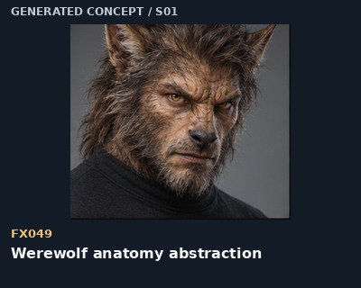 | FX049 - Werewolf anatomy abstraction | For the selected visible region of <Subject 1>, use this animal endpoint: A moderately long canine muzzle, pointed ears, round pupils, dense guard hair and a four-toed paw silhouette. Digitigrade canine hindlimbs; four main weight-bearing paw digits; forelimb dewclaw is medial. Show only the requested stage of the current change. Retain the source shot's identity, framing, lighting, background and existing motion outside the selected region. | Use one region per segment. This is a target anatomy preset, not a claim that the species appears in the cited movie. |
| 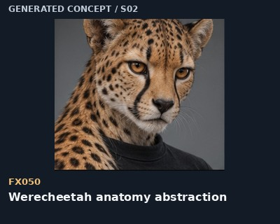 | FX050 - Werecheetah anatomy abstraction | For the selected visible region of <Subject 1>, use this animal endpoint: A slim short feline muzzle, solid black spots, black tear tracks, rounded ears and round pupils. Keep the body light and the tail long. Lean digitigrade limbs; four main paw toes; small, less fully retractile claws. Show only the requested stage of the current change. Retain the source shot's identity, framing, lighting, background and existing motion outside the selected region. | Use one region per segment. This is a target anatomy preset, not a claim that the species appears in the cited movie. |
| 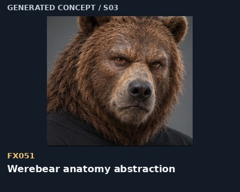 | FX051 - Werebear anatomy abstraction | For the selected visible region of <Subject 1>, use this animal endpoint: A broad bear muzzle, rounded ears, heavy shoulder mass and dense coarse fur. Keep the heel on the ground during a planted stance. Plantigrade hindfeet; five toes with non-retractile claws. Show only the requested stage of the current change. Retain the source shot's identity, framing, lighting, background and existing motion outside the selected region. | Use one region per segment. This is a target anatomy preset, not a claim that the species appears in the cited movie. |
| 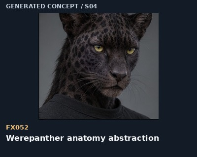 | FX052 - Werepanther anatomy abstraction | For the selected visible region of <Subject 1>, use this animal endpoint: A black leopard hybrid with a broad feline muzzle, rounded ears, round pupils, long tail and faint rosettes visible in reflected light. Specify black leopard or black jaguar; digitigrade felid limbs, retractile claws. Show only the requested stage of the current change. Retain the source shot's identity, framing, lighting, background and existing motion outside the selected region. | Use one region per segment. This is a target anatomy preset, not a claim that the species appears in the cited movie. |
| 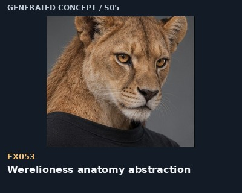 | FX053 - Werelioness anatomy abstraction | For the selected visible region of <Subject 1>, use this animal endpoint: A tawny lioness muzzle, broad nose, rounded ears, round pupils, four main paw toes and a tufted tail. Digitigrade felid limbs; four hind toes, medial forelimb dewclaw; no mane. Show only the requested stage of the current change. Retain the source shot's identity, framing, lighting, background and existing motion outside the selected region. | Use one region per segment. This is a target anatomy preset, not a claim that the species appears in the cited movie. |
| 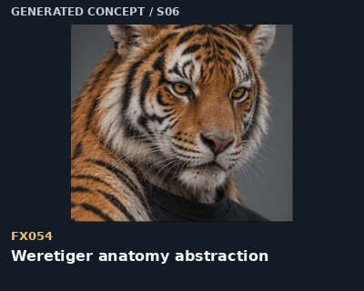 | FX054 - Weretiger anatomy abstraction | For the selected visible region of <Subject 1>, use this animal endpoint: A broad tiger muzzle, rounded ears and orange coat with black stripes that follow the growing anatomy. Digitigrade felid limbs; retractile claws; round pupils. Show only the requested stage of the current change. Retain the source shot's identity, framing, lighting, background and existing motion outside the selected region. | Use one region per segment. This is a target anatomy preset, not a claim that the species appears in the cited movie. |
| 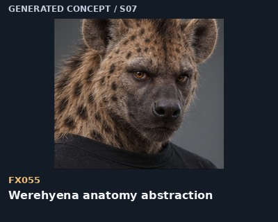 | FX055 - Werehyena anatomy abstraction | For the selected visible region of <Subject 1>, use this animal endpoint: A deep muzzle, rounded ears, heavy neck, spotted coarse coat and a sloping shoulder-to-hip silhouette. Digitigrade; spotted-hyena variant has four toes per foot. Show only the requested stage of the current change. Retain the source shot's identity, framing, lighting, background and existing motion outside the selected region. | Use one region per segment. This is a target anatomy preset, not a claim that the species appears in the cited movie. |
| 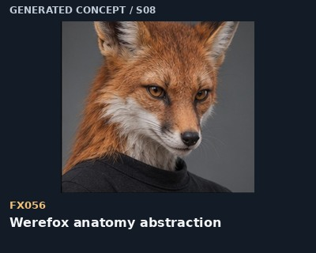 | FX056 - Werefox anatomy abstraction | For the selected visible region of <Subject 1>, use this animal endpoint: A narrow orange fox muzzle, large pointed ears, dark lower legs and a full brush tail. Digitigrade canine plan; main paws have four forward digits. Show only the requested stage of the current change. Retain the source shot's identity, framing, lighting, background and existing motion outside the selected region. | Use one region per segment. This is a target anatomy preset, not a claim that the species appears in the cited movie. |
|  | FX057 - Wereboar anatomy abstraction | For the selected visible region of <Subject 1>, use this animal endpoint: A broad mobile snout disc, coarse bristles, compact triangular ears and paired curved tusks. Even-toed ungulate; two main hooves and smaller side digits. Show only the requested stage of the current change. Retain the source shot's identity, framing, lighting, background and existing motion outside the selected region. | Use one region per segment. This is a target anatomy preset, not a claim that the species appears in the cited movie. |
|  | FX058 - Werebull anatomy abstraction | For the selected visible region of <Subject 1>, use this animal endpoint: A heavy bovine muzzle, lateral ears, massive neck and a matched pair of unbranched horns growing from the frontal bone. Cloven hooves; two principal digits and rear dewclaws; paired keratin horns. Show only the requested stage of the current change. Retain the source shot's identity, framing, lighting, background and existing motion outside the selected region. | Use one region per segment. This is a target anatomy preset, not a claim that the species appears in the cited movie. |
|  | FX059 - Weredeer anatomy abstraction | For the selected visible region of <Subject 1>, use this animal endpoint: A slender cervid muzzle, broad mobile ears, a soft coat and a paired antler rack if the selected deer phenotype has antlers. Cloven hooves; antlers differ from permanent keratin horns. Show only the requested stage of the current change. Retain the source shot's identity, framing, lighting, background and existing motion outside the selected region. | Use one region per segment. This is a target anatomy preset, not a claim that the species appears in the cited movie. |
|  | FX060 - Wererat anatomy abstraction | For the selected visible region of <Subject 1>, use this animal endpoint: A narrow rodent muzzle, rounded bare ears, long whiskers, prominent incisors and a thin scaled tail. Five hind toes; smaller four main front digits plus reduced thumb. Show only the requested stage of the current change. Retain the source shot's identity, framing, lighting, background and existing motion outside the selected region. | Use one region per segment. This is a target anatomy preset, not a claim that the species appears in the cited movie. |
|  | FX061 - Werecrocodile anatomy abstraction | For the selected visible region of <Subject 1>, use this animal endpoint: A broad crocodilian muzzle, nostrils near its tip, scaly skin and a muscular laterally flattened tail. Reptilian limbs; five fore digits and four hind digits for the crocodile endpoint. Show only the requested stage of the current change. Retain the source shot's identity, framing, lighting, background and existing motion outside the selected region. | Use one region per segment. This is a target anatomy preset, not a claim that the species appears in the cited movie. |
|  | FX062 - Werebat anatomy abstraction | For the selected visible region of <Subject 1>, use this animal endpoint: A short bat muzzle, large species-appropriate ears and membranes tensioned between elongated fingers. A bat is a mammal, with fur rather than feathers. Choose an arm-to-wing conversion; elongate fingers II-V; leave the thumb free. Show only the requested stage of the current change. Retain the source shot's identity, framing, lighting, background and existing motion outside the selected region. | Use one region per segment. This is a target anatomy preset, not a claim that the species appears in the cited movie. |
|  | FX063 - Wereeagle anatomy abstraction | For the selected visible region of <Subject 1>, use this animal endpoint: A hooked eagle beak, layered flight feathers and a predatory avian head; wings attach at the existing shoulders. Avian wing replaces the arm; raptor hindfeet have three forward toes and a rear hallux. Show only the requested stage of the current change. Retain the source shot's identity, framing, lighting, background and existing motion outside the selected region. | Use one region per segment. This is a target anatomy preset, not a claim that the species appears in the cited movie. |
|  | FX064 - Wereshark anatomy abstraction | For the selected visible region of <Subject 1>, use this animal endpoint: Smooth grey shark skin, paired side gill slits, a broad shark head and ordered rows of triangular teeth. Choose a fantasy hybrid topology explicitly; fins are not jointed mammal paws. Show only the requested stage of the current change. Retain the source shot's identity, framing, lighting, background and existing motion outside the selected region. | Use one region per segment. This is a target anatomy preset, not a claim that the species appears in the cited movie. |
|  | FX065 - Werehorse anatomy abstraction | For the selected visible region of <Subject 1>, use this animal endpoint: An equine muzzle, upright mobile ears, a mane, single hooves and a long hair-covered tail. Unguligrade; one principal hoof per limb, no cloven split or bovine dewclaws. Show only the requested stage of the current change. Retain the source shot's identity, framing, lighting, background and existing motion outside the selected region. | Use one region per segment. This is a target anatomy preset, not a claim that the species appears in the cited movie. |
|  | FX066 - Werecow anatomy abstraction | For the selected visible region of <Subject 1>, use this animal endpoint: A broad moist bovine nose, lateral ears and a black-and-white short coat; use the chosen hornless individual consistently. Bovine cloven hoof anatomy; horned or hornless depends on the selected phenotype. Show only the requested stage of the current change. Retain the source shot's identity, framing, lighting, background and existing motion outside the selected region. | Use one region per segment. This is a target anatomy preset, not a claim that the species appears in the cited movie. |
|  | FX067 - Bull horns / minotaur anatomy abstraction | For the selected visible region of <Subject 1>, use this animal endpoint: A heavy bovine face and neck, with horns growing sideways from behind the eye line before curving upward. A paired, unbranched horn set; no deer-like branching. Show only the requested stage of the current change. Retain the source shot's identity, framing, lighting, background and existing motion outside the selected region. | Use one region per segment. This is a target anatomy preset, not a claim that the species appears in the cited movie. |
|  | FX068 - Domestic werecat anatomy abstraction | For the selected visible region of <Subject 1>, use this animal endpoint: A short domestic-cat muzzle, upright triangular ears, tabby markings and pupils that narrow vertically under brighter light. Digitigrade cat legs; retractile claws; four hind toes and a medial forelimb dewclaw. Show only the requested stage of the current change. Retain the source shot's identity, framing, lighting, background and existing motion outside the selected region. | Use one region per segment. This is a target anatomy preset, not a claim that the species appears in the cited movie. |
|  | FX069 - Wereraven anatomy abstraction | For the selected visible region of <Subject 1>, use this animal endpoint: A straight black raven beak, black contour feathers, layered wing feathers and small round dark eyes. Avian arm-to-wing plan; one head; no mammal ear pinnae at endpoint. Show only the requested stage of the current change. Retain the source shot's identity, framing, lighting, background and existing motion outside the selected region. | Use one region per segment. This is a target anatomy preset, not a claim that the species appears in the cited movie. |
|  | FX070 - Wereowl anatomy abstraction | For the selected visible region of <Subject 1>, use this animal endpoint: A short hooked beak, a feather facial disc and large forward-facing eyes; rotate the head within plausible limits. Avian arm-to-wing plan; zygodactyl grip can be chosen for perched feet. Show only the requested stage of the current change. Retain the source shot's identity, framing, lighting, background and existing motion outside the selected region. | Use one region per segment. This is a target anatomy preset, not a claim that the species appears in the cited movie. |
|  | FX071 - Wereram anatomy abstraction | For the selected visible region of <Subject 1>, use this animal endpoint: A sheep muzzle, dense wool and a matched pair of curling ridged horns that remain clear of the ears. Cloven hooves; paired ridged spiral horns; wool rather than a fur mane. Show only the requested stage of the current change. Retain the source shot's identity, framing, lighting, background and existing motion outside the selected region. | Use one region per segment. This is a target anatomy preset, not a claim that the species appears in the cited movie. |
|  | FX072 - Weregoat anatomy abstraction | For the selected visible region of <Subject 1>, use this animal endpoint: A narrow caprine muzzle, short beard, horizontal pupils and tapered horns sweeping backward. Cloven hooves; paired backward-curving horns; horizontal pupils. Show only the requested stage of the current change. Retain the source shot's identity, framing, lighting, background and existing motion outside the selected region. | Use one region per segment. This is a target anatomy preset, not a claim that the species appears in the cited movie. |
|  | FX073 - Deep structural creak | A low, short wooden-fibrous creak rises with the visible limb extension and stops as the limb settles. Avoid explosive impacts. Keep the source ambience and any retained dialogue audible; synchronize the cue to the visible event. | growth stress |
|  | FX074 - Irregular joint-set pops | Two or three small dry joint pops occur at the visible joint movements, with uneven spacing and no repeated machine-gun cracking. Keep the source ambience and any retained dialogue audible; synchronize the cue to the visible event. | joint realignment |
|  | FX075 - Tendon stretch | A restrained elastic-fiber strain rises during the tendon tightening and releases immediately after the motion. Keep the source ambience and any retained dialogue audible; synchronize the cue to the visible event. | tendon tension |
|  | FX076 - Skin tension and friction | Add close dry skin friction and a low pressure swell beneath the surface movement; keep it subtle enough to retain breathing. Keep the source ambience and any retained dialogue audible; synchronize the cue to the visible event. | surface tension |
|  | FX077 - Fur emergence rustle | A very fine dry brushing rustle grows with the visible hairs and dies away as the coat settles. Keep the source ambience and any retained dialogue audible; synchronize the cue to the visible event. | coat emergence |
|  | FX078 - Garment stitch tearing | A rising cloth strain resolves into one short stitch rip exactly when the existing seam releases. Keep the source ambience and any retained dialogue audible; synchronize the cue to the visible event. | clothing tension |
|  | FX079 - Claws touching a hard floor | Place separate light keratin taps at the visible claw contacts, then one short scrape as the paw shifts. Match the floor material. Keep the source ambience and any retained dialogue audible; synchronize the cue to the visible event. | claw contact |
|  | FX080 - Paw pads taking weight | Use a soft dense thump with faint surface friction as the pads compress under the visible weight shift. Keep the source ambience and any retained dialogue audible; synchronize the cue to the visible event. | paw contact |
|  | FX081 - Hoof forming and first clop | Follow the keratin growth with a restrained dry creak, then one hard resonant clop at the first visible hoof landing. Match the floor resonance. Keep the source ambience and any retained dialogue audible; synchronize the cue to the visible event. | hoof contact |
|  | FX082 - Feather and wing movement | Layer fine feather rustle with a brief air displacement whoosh synchronized to the visible wing unfold. Keep the source ambience and any retained dialogue audible; synchronize the cue to the visible event. | wing unfolding |
|  | FX083 - Breath becoming animal panting | Transition the subject's existing breath gradually into deeper animal panting while keeping the same exhalation rhythm and visible chest movement. Keep the source ambience and any retained dialogue audible; synchronize the cue to the visible event. | respiratory change |
|  | FX084 - Human vocal strain becoming growl | Blend an original strained exhale into a low chest-resonant growl as the throat and mouth change. Preserve breath continuity rather than switching voices abruptly. Keep the source ambience and any retained dialogue audible; synchronize the cue to the visible event. | laryngeal change |
|  | FX085 - Single wolf howl after the change | Add one breath-led wolf howl only after the muzzle and throat settle, with a natural attack, sustained vowel-like tone and trailing breath. Keep the source ambience and any retained dialogue audible; synchronize the cue to the visible event. | completed canine vocalization |
|  | FX086 - Body-pressure heartbeat pulse | Add two restrained low heartbeat-like pulses under the visible growth surges, keeping the source room tone audible. Keep the source ambience and any retained dialogue audible; synchronize the cue to the visible event. | subjective onset |
|  | FX087 - Heightened hearing perspective | Raise close environmental details and slightly soften distant speech clarity during the visible sensory-change beat; retain the original room acoustics and avoid inventing dialogue. Keep the source ambience and any retained dialogue audible; synchronize the cue to the visible event. | sensory perspective |
|  | FX088 - Controlled silence before reveal | Briefly reduce only the added dramatic layers before the visible reveal, retaining source ambience, then return the physical breath and contact sounds at the reveal. Keep the source ambience and any retained dialogue audible; synchronize the cue to the visible event. | reveal dynamics |
|  | FX089 - Moonlight-triggered onset | On <Subject 1>, begin the selected local change only when the existing moonlit edge reaches that region; match the shot's light direction and keep the rest of the action continuous. Retain the source shot's identity, framing, lighting, background and existing motion outside the selected region. | This is a fictional trigger. Do not add a moon, new room or a global blue lighting change. |
|  | FX090 - Silver interruption | On <Subject 1>, stop the selected morph at its current intermediate shape at the visible contact cue, hold the structural tension briefly and retain that partial state. Retain the source shot's identity, framing, lighting, background and existing motion outside the selected region. | Use only when a silver-contact cue is already established in the larger scene; do not invent a prop or injury. |
|  | FX091 - Asymmetric incomplete transformation | On <Subject 1>, advance only the selected side or limb into the requested animal shape while keeping the opposite side at its current stage; sustain the asymmetry through the segment. Retain the source shot's identity, framing, lighting, background and existing motion outside the selected region. | Name left/right from the subject's perspective. Avoid accidentally mirroring the selected side. |
|  | FX092 - Reverse local transformation | On <Subject 1>, reverse the selected local change continuously: shorten the muzzle or limb toward its prior shape, retract the coat and settle the original surface without a dissolve. Retain the source shot's identity, framing, lighting, background and existing motion outside the selected region. | Choose one mechanic to reverse. Preserve the prior endpoint as the destination, not a new human identity. |
|  | FX093 - Shadow-led transformation reveal | On <Subject 1>, show the selected shape change first in the subject's existing cast shadow, then bring the matching local body change into view without adding a cut. Retain the source shot's identity, framing, lighting, background and existing motion outside the selected region. | Preserve the original light source and shadow contact. Do not turn this into a different monochrome scene. |
|  | FX094 - Remove unwanted eye glow | On <Subject 1>, replace emitted eye glow with naturally pigmented irises and shot-matched corneal highlights, keeping the current pupil shape and eye position. Retain the source shot's identity, framing, lighting, background and existing motion outside the selected region. | Keep the selected iris color; remove halos and light spill only. |
|  | FX095 - Preserve identity through a local morph | On <Subject 1>, apply the requested deformation only inside the selected region and retain distinctive scars, pigment, hairline and expression outside it as stable identity anchors. Retain the source shot's identity, framing, lighting, background and existing motion outside the selected region. | This repairs identity drift. Do not force original human proportions inside the region that must actually transform. |
|  | FX096 - Repair duplicated digits and limbs | On <Subject 1>, resolve duplicated anatomy into the chosen species' topology, maintaining continuous connections from the existing limb and a single claw or hoof per selected digit. Retain the source shot's identity, framing, lighting, background and existing motion outside the selected region. | Set the endpoint digit map first. Delete duplicates rather than hiding them with fur or motion blur. |
|  | FX097 - Restore both ears | On <Subject 1>, restore the missing ear as the anatomically matching partner of the visible ear, aligned in perspective and attached at the proper stage-dependent position. Retain the source shot's identity, framing, lighting, background and existing motion outside the selected region. | Keep one left and one right ear; match occlusion rather than forcing both fully visible in every view. |
|  | FX098 - Prevent reference background contamination | On <Subject 1>, transfer only the selected deformation mechanics from the attached reference onto the target anatomy, retaining the target's room, floor, props, outfit, viewpoint and light sources. Retain the source shot's identity, framing, lighting, background and existing motion outside the selected region. | The reference contributes motion and surface behavior only. Its actor, set and camera are not edit targets. |
|  | FX099 - Keep the chest closed during growth | On <Subject 1>, maintain a continuous outer chest surface while reshaping the shoulders, ribcage and shirt; let growth show through contour, muscle motion and fabric tension. Retain the source shot's identity, framing, lighting, background and existing motion outside the selected region. | Replace any accidental cavity with the subject's continuous external surface. No new opening, hollow torso or visible internal anatomy. |
|  | FX100 - Freeze the requested intermediate stage | On <Subject 1>, advance the selected local change only to the requested intermediate state, then hold its anatomy stable while breathing and the source performance continue. Retain the source shot's identity, framing, lighting, background and existing motion outside the selected region. | State the visible endpoint in words. A percentage is a creative guide, not a calibrated model parameter. |
